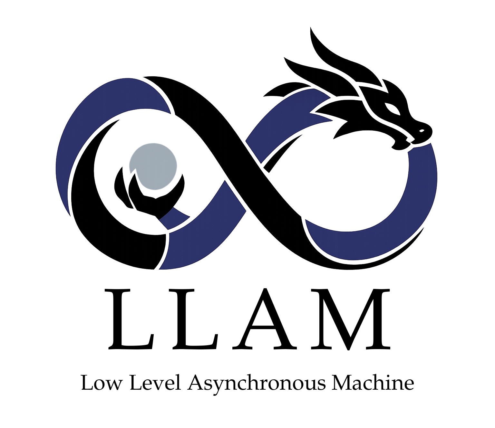

<p align="center">
  
</p>


[](LICENSE)

# LLAM

Welcome to [LLAM](https://feralthedogg.github.io/LLAM/)!
LLAM, the Low Level Asynchronous Machine, is a stackful user-thread runtime for C.
Write blocking-style C with tasks, channels, and I/O, while the runtime schedules
many tasks over a smaller set of OS threads and parks waits on io_uring, kqueue, and
IOCP.

In 3.0, `llam_runtime_create()` and `llam_runtime_init()` require asynchronous
preemption for compiler-qualified tasks. Compile task code with the LLVM 23.1.2
[managed C toolchain](docs/guides/managed-c.md); `llam-clang` uses required managed
mode by default. Unqualified task entries and unsupported native profiles are
rejected. Native C compatibility is an explicit choice through
`llam_runtime_create_compat()` or `llam_runtime_init_compat()`.

Some handy links:

 * [Documentation](https://feralthedogg.github.io/LLAM/)
 * [Quickstart](https://feralthedogg.github.io/LLAM/start/quickstart/)
 * [Examples](https://feralthedogg.github.io/LLAM/examples/)
 * [Public API](https://feralthedogg.github.io/LLAM/reference/api/)
 * [Platform support](https://feralthedogg.github.io/LLAM/start/platforms/)
 * [Production checklist](https://feralthedogg.github.io/LLAM/production/checklist/)
 * [Changelog](https://feralthedogg.github.io/LLAM/project/changelog/)
 * [Roadmap](https://feralthedogg.github.io/LLAM/project/roadmap/)
 * [Issue tracker](https://github.com/Feralthedogg/LLAM/issues)

## What you can do with it

 * [Run tasks with their own stacks](https://feralthedogg.github.io/LLAM/concepts/execution-model/): spawn, join, sleep, and deadlines in ordinary C control flow.
 * [Pass values between tasks](https://feralthedogg.github.io/LLAM/concepts/synchronization/): channels, select, mutexes, conditions, and cancellation.
 * [Write I/O that looks blocking](https://feralthedogg.github.io/LLAM/concepts/io-model/): the task parks, and the worker keeps running other tasks.
 * [Preempt CPU loops with managed C](https://feralthedogg.github.io/LLAM/guides/managed-c/): compiler-qualified C with asynchronous preemption.
 * [Embed it in a host](https://feralthedogg.github.io/LLAM/guides/embedding/) or [bind it from another language](https://feralthedogg.github.io/LLAM/reference/abi/) through a stable C ABI.
 * [See why a task is stuck](https://feralthedogg.github.io/LLAM/guides/diagnostics/): stats and runtime dumps with wait ownership.

## Install

Linux and macOS:

```bash
curl -fsSL https://github.com/Feralthedogg/LLAM/releases/latest/download/install.sh | sh -s -- --prefix "$HOME/.local"
```

Windows:

```powershell
Invoke-WebRequest "https://github.com/Feralthedogg/LLAM/releases/latest/download/install.ps1" -OutFile install.ps1
.\install.ps1 -Prefix "$env:LOCALAPPDATA\LLAM"
```

Then link it from CMake and run your first task with the
[Quickstart](https://feralthedogg.github.io/LLAM/start/quickstart/).

## Building

Linux needs `build-essential` and `liburing-dev`:

```bash
make -j4 CC=gcc
make test
```

macOS needs the Xcode command-line tools:

```bash
CC=clang make -j4
make test
```

Windows builds through CMake from an x64 Visual Studio developer shell or a configured
MinGW environment:

```powershell
cmake -S . -B build-windows -G "Ninja" -DCMAKE_BUILD_TYPE=Release -DLLAM_ENABLE_WINDOWS_BACKEND=ON
cmake --build build-windows
ctest --test-dir build-windows --output-on-failure
```

See [Build from source](https://feralthedogg.github.io/LLAM/start/build/) for CMake,
install prefixes, and managed SDK builds.

## Important make targets

- `all` - build the runtime libraries, examples, and benchmarks
- `test` - build and run the API, ABI, runtime, broker, and shared-load tests
- `test-quick` - `test` plus the quick composite server stress
- `test-hardening` - static analysis, dependency audit, sanitizers, and heavy fuzz
- `verify-linux`, `verify-darwin`, `verify-windows` - the platform-local gate
- `package` - build a release archive
- `clean` - remove generated files

The [Verification](https://feralthedogg.github.io/LLAM/production/verification/) guide
covers stress, soak, and release gates, and the
[CLI tool map](https://feralthedogg.github.io/LLAM/reference/cli/) covers every program
a build produces.

## Contributing

Please review the [contributing guidelines](CONTRIBUTING.md) before opening a pull
request. Report documentation problems and runtime defects through the
[issue forms](https://github.com/Feralthedogg/LLAM/issues/new/choose), and security
defects [privately](.github/SECURITY.md).

## License

LLAM's first-party code, documentation, tests, examples, and build tools are licensed
under the [Apache License, Version 2.0](LICENSE). Separately licensed dependencies
retain their own terms; see [THIRD_PARTY_NOTICES.md](THIRD_PARTY_NOTICES.md) and
[Licensing](https://feralthedogg.github.io/LLAM/project/licensing/).
