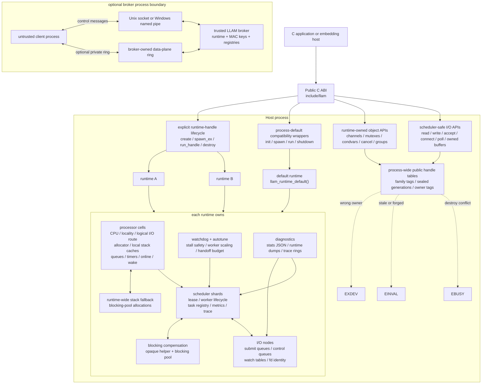
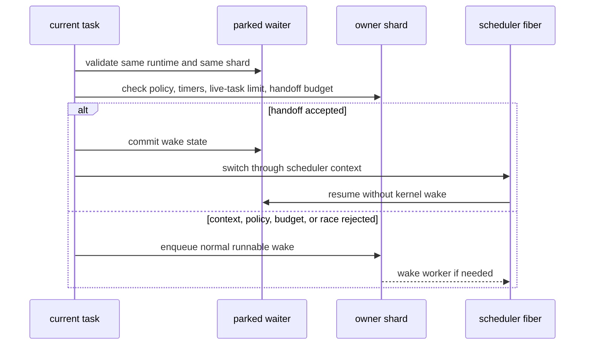

# Architecture

This page summarizes the implementation boundaries. The public contract remains
the headers under `include/llam/`; internal file names and layouts are not ABI.

## Boundary Map

LLAM is organized around explicit runtime handles. The legacy process-default
runtime is still available, but embedding hosts should use
`llam_runtime_create()`, `llam_runtime_spawn_ex()`,
`llam_runtime_run_handle()`, and `llam_runtime_destroy()`.

## Runtime Ownership

Every runtime-aware object is owner-tagged when it becomes public. Managed use
from another runtime fails with `EXDEV` before object storage is dereferenced.
Consumed or stale public handles fail with `EINVAL`; live public operations can
hold active pins that make destroy paths fail with `EBUSY` instead of racing
reclamation.

Explicit runtimes own scheduler shards, processor cells, I/O nodes, active
allocation caches, blocking workers, and live tasks. Processor cells own the
scheduler wake descriptor and pending word; I/O nodes keep their own backend
wake resources. Process-wide reusable storage is allowed only after the object
is owner-poisoned; acquisition restamps the current runtime before a new public
handle is returned.

## Scheduler

LLAM is an N:M stackful scheduler. Each task is a `void (*)(void *)` function
with its own stack. OS worker threads execute managed tasks through a shard's
single P owner. The processor cell owns runnable and timer-heap storage, its
allocator, and per-P stack caches; `shard->lock` remains the first migration's
payload lock. Diagnostic task lists, metrics, trace state, and worker contexts
remain on the shard. The processor-owned runnable lanes are:

- `hot_q` for latency-class work and completions.
- `norm_q` for ordinary runnable work.
- `inject_q` for cross-shard or host-injected work.
- a timer heap for sleeps and timed waits.
- per-P allocation caches and remote-free queues for tasks, wait nodes, timer
  nodes, I/O requests, and I/O buffers.
- a per-P stack cache, with a separate runtime-wide stack fallback cache.
- a scheduler fiber context used to switch into managed tasks.

Balanced and debug-safe profiles prewarm one 16-object task slab per processor;
release-fast and io-latency retain a 128-object reserve. `LLAM_TASK_CACHE_PREWARM`
overrides these defaults. Owned I/O buffers allocate only the inline payload
needed by small requests, rounded to 16 bytes; large or explicitly aligned
payloads use a compact header and separate storage. Public buffers remain
detached from processor slabs so their handles can outlive the runtime.

Unmanaged host spawns use a separate adaptive task-span pool under the owning
processor's allocator lock. Spans start at one task, grow geometrically, and
stop at a page-density capacity of at most 16 tasks. Small ramps use the system
heap; mature spans use a dense page mapping, with a tracked heap fallback if
mapping fails. Allocation prefers partially occupied spans and keeps at most
two completely empty reusable spans per processor. Old empty spans are retired
as a batch under the task registry lock, then their resources and backing pages
are released after the allocator lock is dropped. Active public pins, scan refs
or registry contention quarantine the entire span for later retry; quarantined
storage is never reused. A shared pending hint lets owner safepoints finish one
retirement at a time without adding an atomic to the managed alloc/free path.
Inactive runtimes finish remaining retirement on later activity or teardown.
Partially live spans and the process-global handle table can still retain
memory. Heap fallback storage returns to libc and may remain in its own caches.

Multi-channel select keeps its first four wait nodes in the suspended select
call's fiber stack frame; wider selects borrow additional processor wait nodes.
Tasks do not reserve select nodes or initialize them at spawn. The ready-only
path does not initialize scratch waiters. Queue cleanup, cancellation-resolver
drain, and timer-reference drain finish before the frame returns, so scratch
waiters share the lifetime of the existing stack-backed select state.

Processor stack caches keep warm payloads up to 16 MiB for default stacks and
8 MiB each for large and huge stacks in balanced and debug-safe profiles.
Release-fast and io-latency retain their larger warm limits. The runtime-wide
fallback keeps a shared warm reserve of 32 MiB for
default stacks and 8 MiB each for large and huge stacks, and consumes warm
entries before cold entries. Further overflow receives platform-specific
discard advice to release or mark payload pages reclaimable. Guard pages and
virtual mappings remain available for reuse, and Darwin reuse accounting is
restored before context initialization. Advice is opportunistic; a failed hint
does not invalidate a cached stack. Existing mapping-count limits still bound
the fallback cache.

The processor cell also owns timer count and callback accounting. Timer-node
`owner_shard` remains its allocator/cache return destination; a separate task
field identifies the active timer-heap owner so cancellation can retry safely
across rehome. The I/O node continues to own its platform backend and node wake
state.

Remote spawns, cross-shard wakes, and timer completions publish through the
processor inject queue (or runtime overflow). Only the current M's
generation-checked P queue access can mutate the local hot/normal lane or the
lock-free normal-deque bottom. STOPPING drain and opaque redirect release use
distinct private access modes; the lease remains the execution authority.
Dynamic offline waits for timer callbacks to quiesce, reserves target capacity,
validates wait generations and pins wait ownership, then moves timer nodes under
the ordered source/target locks. A failed preflight or reserve keeps the source
heap and task ownership unchanged.

The scheduler loop drains injected work with a budget, fires timers, takes hot
work first, then normal work, then steals. If no work is ready, it waits on the
processor wake handle for that platform.

Context switching is direct fiber switching through the platform context path:
hand-written assembly on supported architectures, with a portable fallback where
needed. Default automatic preemption is request-based; watchdog/runtime policy can mark
a task, but a task switches only at LLAM boundaries such as yields, waits, I/O,
or safepoints.

### Phase 0 Worker Identity Boundary

Phase 0 kept the shard as the scheduling authority. Phase 1A adds the single
legacy execution lease and makes the validated lease owner's worker-local
`active_g` plus run/safepoint/idle timestamps authoritative for execution
publication. The P owns its allocator and processor-local stack cache. The
shard still owns I/O-node backend state, public metrics, task registries, and
trace state; worker cells do not copy those resources.
Watchdog targets are derived from the validated lease owner's live worker
binding. The
primary worker and opaque helper worker each receive a distinct slice of the
shard's combined alternate-signal-stack mapping; each owning thread installs,
restores, and clears only its own slice. Phase 1B moved the immutable
CPU/locality/I/O-route tuple, online state, ordinary scheduler wake pair,
runnable queues, and active timer heap into the stable processor cell. The wake
descriptor remains open across online/offline transitions and closes only
after runtime workers stop. The processor owner projection is generation-checked
under the existing `shard->lock`, the first P payload lock, and transactionally
composed with lease changes under `opaque_lock -> shard->lock`. The Phase 1A
lease remains the sole execution-publication authority; a P ticket is a
non-owning snapshot that must be revalidated at each operation boundary.
Per-P allocator and stack-cache state now follow the stable processor cell;
allocation-owner IDs remain separate from task home/live placement, and the
runtime-wide stack fallback remains runtime-owned. Logical I/O route accessors
resolve through P while attached requests continue to use their node-owned
completion route. See the [Phase 1B
processor-resource contract](../superpowers/specs/2026-09-09-phase1b-processor-resources.md)
for the full state table, ticket, lock, and lifetime rules.

### Phase 1A lease transition boundary

The `test_legacy_lease_internal` target observes the Phase 1A coordinator only
through declarations guarded by `LLAM_ENABLE_TEST_HOOKS`. Its snapshot copies
the lock-protected lease record; it does not derive ownership from the legacy
`current` or helper/redirect flags. The transfer-request, owner-clear, grant,
and handback gates are called only after releasing scheduler locks, so focused
tests can inspect each publication window without changing production
behavior. The watchdog gate covers the signal boundary after its task scan
reference is held; a stale lease/binding skips the advisory signal.

The Phase 1A execution-publication inventory is intentionally worker-local:
`scheduler.c`, `blocking_api.c`, `yield_join_sleep.c`, `reinject.c`,
`wait_tracking.c`, and task-exit paths publish or clear `worker->active_g` only
after state and timestamp preparation. `core_queue.c`, watchdog merge/probe/
scale paths, and `debug.c` inspect the validated lease owner's active-G through
`llam_shard_load_lease_current` while holding `opaque_lock` before
`shard->lock`; no shard-level current field remains.

* Watchdog target: `scheduler.c`
  (`llam_legacy_lease_snapshot_watchdog_locked`) snapshots the validated lease
  owner, incarnation, epoch, and native binding under `opaque_lock`;
  `watchdog_probe.c` acquires a task scan reference, revalidates that tuple, and
  sends only the existing advisory `pthread_kill` request. There is no mutable
  shard-side target field.
* `opaque_helper_active`: `timer.c` (`llam_ensure_opaque_helper_locked`) resets
  the projection under `opaque_lock` before helper creation; `scheduler.c`
  (`llam_opaque_helper_main`) writes helper readiness/activation and exit
  projections; `blocking_api.c`
  (`llam_enter_blocking`, `llam_leave_blocking`) reads the projection while
  waiting for helper activation/return; `watchdog_probe.c`
  (`llam_runtime_has_opaque_blocking`) reads it under `opaque_lock`; `debug.c`
  (`llam_dump_runtime_state`) reports it; and `timer.c`'s test-hook snapshot
  reads it under `opaque_lock`.
* `opaque_compensation_depth`: `blocking_api.c` (`llam_enter_blocking`,
  `llam_leave_blocking`) increments/decrements it and maintains its peak;
  `scheduler.c` (`llam_opaque_helper_main`) reads it to decide whether the
  helper should fetch or hand back; `watchdog_probe.c`
  (`llam_runtime_has_opaque_blocking`) reads it under `opaque_lock`; and
  `debug.c` (`llam_dump_runtime_state`) reports both depth values.
* Pause acknowledgements: `init.c` initializes `merge_pause_ack` and
  `steal_pause_ack` plus their request/ACK sequence, lease-epoch, and worker
  incarnation fields; `watchdog_merge.c` (`llam_runtime_set_steal_pause`,
  `llam_runtime_wait_steal_pause_ack`, `llam_shard_request_merge_pause`,
  `llam_shard_release_merge_pause`, `llam_shard_wait_merge_pause_ack`, and
  `llam_merge_lockfree_normq_locked`) clears, waits on, or validates them;
  `scheduler.c` (`llam_shard_pause_for_merge`) publishes and clears both
  acknowledgements while pausing; and `watchdog_scale.c`
  (`llam_runtime_offline_one_shard`) consumes the pause-wait results. The
  acknowledgement fields remain atomic and are versioned by the pause request
  sequence, lease epoch, and acknowledged worker incarnation. A boolean ACK is
  valid only when all three values still match the live lease owner under
  `opaque_lock`.

Phase 1A completed the migration of transfers, current-G publication, watchdog
targeting, and pause generations into the shard-owned legacy lease boundary
without introducing a second authority. Phase 1B has moved processor topology
and the ordinary scheduler wake pair while keeping the legacy lease as the
execution authority. Public headers, public statistics, and the exported ABI
remain unchanged. Queue, timer, allocator, processor-local stack-cache, and
logical I/O-route ownership now follow the processor-cell authority. Phase 2
adds generation-checked M/G/P foreign detach/reattach through the existing
helper/redirect handoff and gates relief and watchdog decisions on safe worker
state plus a live P ticket. See [Phase 2 Foreign Detach and Fail-Closed Relief
M](../superpowers/specs/2026-09-09-phase2-foreign-detach.md). Rust, Python,
JVM, .NET, and Go language wrappers are explicitly out of scope per the user's
instruction.

Phase 3 adds an opt-in experimental Linux x86-64 async context path for
manually registered safe intervals. It reserves a process-wide real-time
signal only when the prior disposition is default, validates the live M/G/P
ticket and execution generations, and captures into two preallocated G-owned
capsule banks. A dedicated M landing path returns to the scheduler before
publishing `READY`; origin-M dispatch restores through a fresh Linux signal
frame. Restore observation and bank retirement are separate, and direct
task-to-task handoffs are disabled in activated experimental runtimes. Default builds remain cooperative;
unknown PCs and unsupported contexts defer instead of being captured. The
experiment prepares every configured primary, probes each native binding behind
an all-worker startup barrier, and binds started Gs to their origin M through
yield, wait and offload completion. Origin-ready queues and service pins are
separate from ordinary stealable P queues. It refuses helper-M activation and
returns `ENOTSUP` from `llam_enter_blocking()` while enabled; declared callback
offload remains supported with bounded admission tickets. A private async drain
service keeps accepted execution alive through stop without widening ordinary
STOPPING ticket rules. It
is not a general-purpose mechanism for arbitrary C or foreign code. See
[Phase 3 Async Context Capture](../superpowers/specs/2026-09-09-phase3-async-context.md).

Phase 6 adds the versioned `.llam.preempt` metadata parser/inspector and an
optional LLVM pass plus `llam-clang` driver. Cooperative polls are inserted only
at proven natural-loop latches. Async-safe annotations are limited to
structurally restricted Linux x86-64 leaf code and remain an explicit author
review obligation. `off`/`auto`/`required` are opt-in build/tooling modes;
`required` verifies the final link contains at least one accepted range. The
runtime does not automatically load or register these records, so metadata
does not enable async preemption. The private module-registration hook can
validate and copy `ASYNC_SAFE` ranges against an image before enable; absent
optional metadata is a legacy no-op and required metadata fails closed. Default
runtime behavior stays cooperative.
See [Compiler preemption metadata](../tooling/preempt-metadata.md). Rust,
Python, JVM, .NET, and Go language-binding wrappers are not included.

Phase 7 records compiled async capability, safe-range readiness, active backend,
and deterministic fallback reason privately on each runtime. `OFF` stays off,
`COOPERATIVE` stays cooperative, and `AUTO`/`STRICT` use hybrid capture only
when the experimental Linux x86-64 backend is enabled with safe ranges; all
other PCs remain deferred to a safepoint. Unsupported platforms report
cooperative fallback/`ENOTSUP`. Internal dumps include async capture, collision,
context-byte, and acknowledgment-latency metrics alongside foreign-detach and
relief-worker counters. Public structs, exports, and JSON statistics remain
unchanged. See [Phase 7 capability and fallback policy](../superpowers/specs/2026-09-15-phase7-capability-policy.md).

### Phase 1A boundary audit

`scripts/check_legacy_lease_boundary.py` composes the unchanged Phase 0
worker-identity scanner with the narrow Phase 1A allowlist.  `active_g` is
allowed only as the field of `struct llam_worker`, during initialization of the
embedded `primary_worker` and `opaque_helper_worker` slots, and inside the
three `llam_worker_{publish,load,clear}_active_g` helpers in `scheduler.c`.
Every other direct `active_g` use remains a boundary error. The audit also
rejects a shard-level `current` or `preempt_thread` authority, duplicate
processor topology/wake, queue/timer, or allocator/cache fields on the shard,
copied node backend/task registry/metrics/trace/opaque-helper-wake/lease state
on the processor cell, bare pause
ACK decisions without request/epoch/incarnation matching, watchdog targets not
held through the lease snapshot and revalidation, reverse `opaque_lock`/
`shard->lock` acquisition, and ownerless lease grants without a validated
claimant. It scans only the native C runtime sources; Rust, Python, JVM, .NET,
and Go language wrappers remain explicitly excluded by user scope.

The checker is intentionally a conservative lexical audit rather than a full C
parser or preprocessor/data-flow engine.  Its exact canonical allowlist is:
the worker `active_g` declaration, two shard-slot initializers, and three
direct worker helpers; merge/steal matchers with a positive request bit and
generation plus the ACK bit and all three exact lease/worker tuple comparisons;
direct tuple sampling arguments/publication stores with stable field provenance;
direct lease-coordinator origins and the four named owner transitions (plus
the audited init/finalize/redirect/unbind clears); the two watchdog snapshots,
exact positive/failure guards, active-G check, and lock-held signal; and direct
pthread scheduler locks with a visible first/second ID order.  Reassignments,
compound/unary or macro-hidden writes, parenthesized/cast/comma lvalues,
unknown ACK/owner/lock wrappers, unsupported pointer/address aliases,
conditional nonzero tuple stores, duplicate tuple/ACK stores, any tuple/ACK
store after the sole nonzero ACK, noncanonical indices, and proof markers in
unreachable or non-dominating branches are rejected rather than inferred.  A
publication's conditional zero-reset stores are allowed only before that
publication edge; the tuple values themselves remain unconditional and
field-derived. Trylock/timedlock success is treated as held for ordering
purposes, and watchdog failure exits must use the braced direct-return shape.
Macro expansion and compiler-specific control-flow semantics are not inferred;
any future source shape that needs those semantics must add an explicit
audited helper or a dedicated checker update.  These are lexical
canonical-allowlist rules, not a replacement for a C parser, preprocessor, CFG,
or whole-program data-flow analysis. Phase 1B queue, timer, allocator, cache,
and logical I/O-route ownership is implemented. Phase 2 foreign detach/reattach
and fail-closed relief checks are implemented. Phase 3 async context capture is
experimental and opt-in; Rust, Python, JVM, .NET, and Go wrappers remain
explicitly excluded. Phase 6 compiler metadata tooling is implemented, but its
records are not automatically registered with the runtime. Phase 7 private
capability and fallback reporting is implemented without extending the public
ABI or stats schema.

Make and CMake use the same `scripts/audit_production_test_hooks.py` policy
for both production static and shared artifacts.  The checker invokes
`nm -a` (falling back to `llvm-nm`), rejects uppercase externally defined
`llam_*_test_*` symbols, permits lowercase/local no-op fallback symbols in
unoptimized Debug artifacts, and retains the existing
`llam_broker_client_self_test_*` symbols as the sole named exception.  Make
uses the configured `$(PYTHON)` interpreter; CMake registers the audit when
Python 3 is found and marks it skipped with code 77 when neither symbol tool
is available.  The native source and Phase 0 checks remain required for
normal supported builds.

## Wake Handoff Fusion

The normal wake path publishes a waiter as runnable, enqueues it on the owner
shard, and wakes a worker if needed. Wake Handoff Fusion is the faster same-shard
path used by latency-sensitive internal producers:

The optimization is intentionally bounded. `direct_handoff_budget` limits long
handoff chains, `direct_handoff_live_limit` avoids applying it to oversized
fanout, and timer guards keep timer-heavy workloads from being starved unless
the runtime explicitly allows timer overlap. Every rejected path falls back to
the ordinary wake/enqueue path.

Metrics split yield handoff and wake handoff attempts, hits, policy failures,
budget failures, no-work failures, push failures, and wake races. These counters
feed diagnostics and the watchdog-attached autotune governor.

## Watchdog And Autotune

The 1ms watchdog is the safety loop. It checks safepoint progress, observes
queue pressure, scales dynamic workers when that experiment is enabled, pauses
and merges shards, and rehomes parked waiters or I/O ownership when a shard is
offlined.

Idle queues and an unchanged progress counter start a deadlock suspicion. Before
publishing `EDEADLK`, the controller uses a cold confirmation pass: it tries every
P lease lock and then every payload lock in P-ID order, checks runnable/native
service obligations, and verifies that every live G is parked on a mutex or join
owned by another G in the same parked set. Every dependency must belong to an
actual wait queue. A finite closed dependency set proves a cycle. Lock contention,
changed wait publication, unlisted work, or an incomplete scan produces an
inconclusive decision. The pass allocates before acquiring locks and never waits
for a scheduler worker or wait-object lock.

Wait snapshots retain the existing wait-resolver reference, which prevents node
and object reclamation while the controller reads them. Acquiring/releasing that
reference does not increment progress metrics. Completed handles and allocated
capsules can retain storage after execution has ended. The shared native adapter
separately checks capture/restore operations, gates, mailboxes, and retirement;
adapters without a precise snapshot defer deadlock confirmation while async
preemption is enabled. The bounded cold pass currently examines at most 64 Ps,
4,096 listed tasks including retained completed tasks, and 4,224 registered Ms;
larger or unstable snapshots remain inconclusive.

The opt-in Linux x86-64 async-preemption experiment can run across multiple
primary workers. Each started task stays affine to its first-dispatch worker
until its saved stack is retired. With dynamic workers enabled, the scaler may
offline only a fully empty worker with no async task or blocking-job service
obligations, and it never migrates queues or I/O ownership for this mode. A
started task prevents its worker from going offline even while the task is
parked or running a blocking callback. Queue pressure can reactivate an offline
worker; new tasks run only after that worker has passed the normal startup
qualification. Worker-ring mode cannot be combined with async preemption.
This path is experimental and is separate from native production qualification.

The opt-in Linux x86-64 async-preemption experiment can run across multiple
primary workers. Each started task stays affine to its first-dispatch worker
until its saved stack is retired. With dynamic workers enabled, the scaler may
offline only a fully empty worker with no async task or blocking-job service
obligations, and it never migrates queues or I/O ownership for this mode. A
started task prevents its worker from going offline even while the task is
parked or running a blocking callback. Queue pressure can reactivate an offline
worker; new tasks run only after that worker has passed the normal startup
qualification. Worker-ring mode cannot be combined with async preemption.
This path is experimental and is separate from native production qualification.

Autotune is attached to that watchdog thread, not implemented as a managed LLAM
task. It rotates low-frequency metric windows without allocation, blocking, or
user callbacks. Modes are:

- `off`: no governor.
- `observe`: publish sampled windows and decisions without changing policy.
- `on`: adjust the direct handoff budget through guarded probes.
- `frozen`: keep the published state stable for diagnostics.

The current actuator is the handoff budget. It probes only when the sampled
handoff data suggests the current budget is constraining useful handoff work.
Probe decisions require enough attempts and hits before commit; insufficient
traffic extends the probe instead of forcing rollback. Hard push/race failures
or an optional wake-latency p99 guardrail back the budget off.

## I/O Nodes

Task-facing I/O looks blocking, but managed tasks park instead of pinning a
scheduler worker. Each call follows this shape:

1. Try a direct nonblocking path.
2. Cooperatively yield and retry when local work may produce readiness.
3. Submit to the runtime-owned backend if supported.
4. Fall back to a blocking helper when the backend cannot own the operation.

Backends are runtime-owned:

- Linux nodes own `io_uring` state, CQE processing, and fd identity tracking.
- macOS nodes own kqueue readiness, `EVFILT_USER` wakes, and shared
  watch state. Darwin-only Mach hints stay behind Darwin guards.
- Windows nodes own IOCP ports, Winsock overlapped operations, HANDLE
  `ReadFile`/`WriteFile`, and version-specific batching policy.

Requests carry owner-runtime and owner-shard information so completions wake the
correct task. Close helpers such as `llam_close()` and `llam_close_handle()`
mark the runtime-local descriptor boundary before the platform close.

## Blocking Compensation

`llam_enter_blocking()` and `llam_call_blocking_result()` keep foreign blocking
work from pinning scheduler progress. A shard-level opaque helper can take over
the local scheduler while the primary worker is in a blocking region. The
runtime-wide blocking pool handles explicit blocking jobs and reports completion
back to the owner runtime.

The [internal magic2 bridge](magic2.md) uses that blocking pool for tagged
kernel and graph requests from managed tasks, preserving cancellation drain
and the existing execution-lease/P ownership boundary.

## Diagnostics

Runtime stats and dumps are architecture features, not add-ons. Dumps include
lifecycle state, stop flags, live tasks, active I/O waiters, blocking helper
state, node queues, processor scheduler-wake ownership, wait ownership, cancellation state,
handoff counters, and autotune state. Rare shutdown, cancellation, lost wakeup,
select fanout, blocking helper, and I/O ownership failures should be reduced
into focused direct runtime tests.

## Broker Boundary

In-process public handles harden misuse, stale use, wrong-family casts, and
cross-runtime ownership mistakes. They are not a sandbox against code that can
read or corrupt the process memory.

The broker path is the isolation direction for hostile or memory-unsafe clients.
The broker owns runtime state, MAC keys, descriptors/HANDLE authority, grants,
revocation state, and private ring sessions outside the untrusted address space.
See [Security Model](../security.md).
