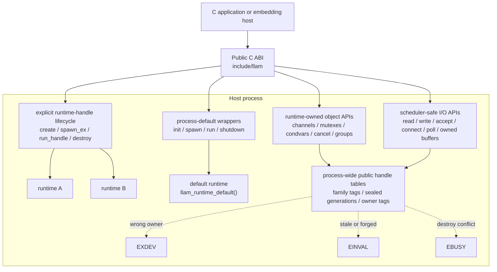
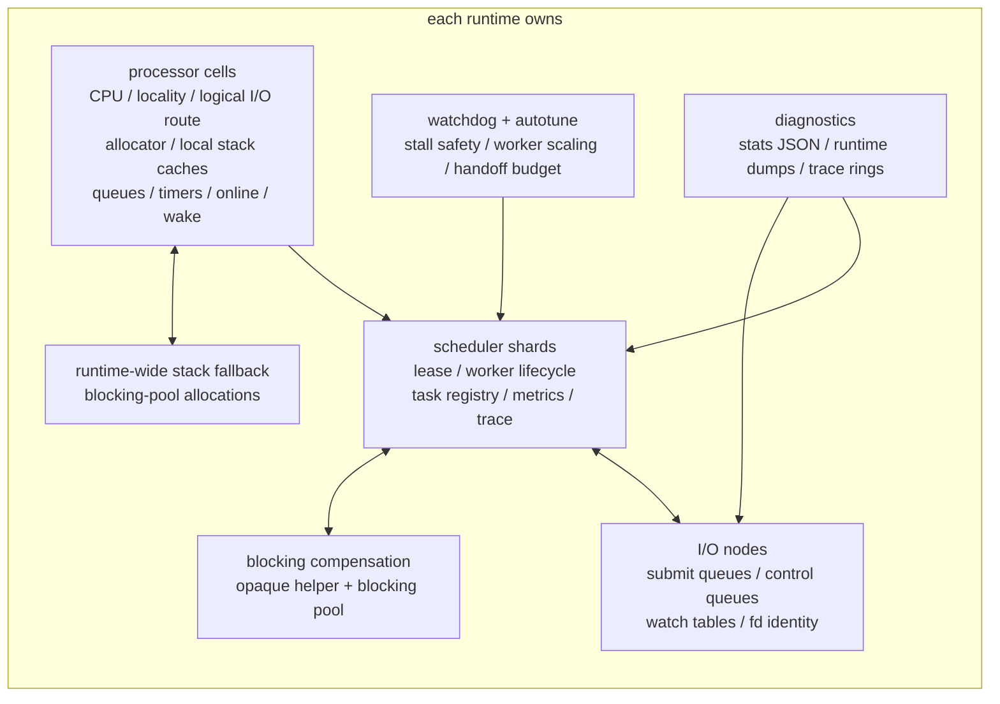
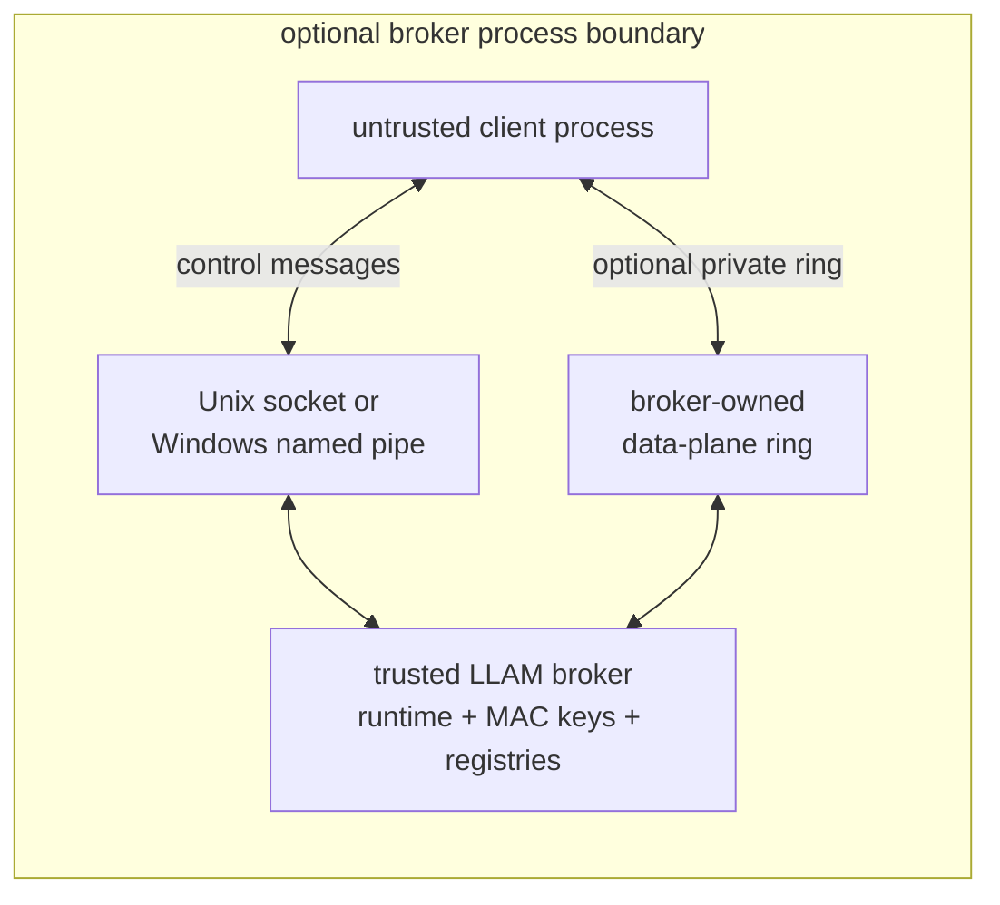

# Architecture

This page summarizes the implementation boundaries. The public contract remains
the headers under `include/llam/`; internal file names and layouts are not ABI.

## N:M model

LLAM is a user-level N:M thread scheduler. Portable tasks share OS workers and
processor capacity; native-affine tasks retain a dedicated native worker. Each task
has its own stack. Cooperative transfers can stay in user space, while qualified
asynchronous capture uses the platform's kernel transport.

| Unit | What it is |
| --- | --- |
| Task | A `void (*)(void *)` function with its own guarded fiber stack. |
| Processor (P) | Owns scheduler queues, timers, and allocation state, retained in shard storage. Compatibility workers normally keep their home P. Registered managed workers (Ms) acquire and return P execution leases, so a P is not permanently tied to one native M. |
| Node | A platform I/O backend: an `io_uring` ring on Linux, a kqueue fd on macOS, or an IOCP port on Windows, plus watch tables, submit queues, and control queues. Shards submit I/O requests to nodes, and nodes complete requests back to the owning shard's task. |

The ordinary and managed constructors default to `ASYNC_REQUIRED`: LLVM-qualified C runs with native
asynchronous preemption after loaded-image validation and a probe on every selected
OS thread. Full snapshots return on their original M with a fresh P execution lease.
Native-affine tasks retain a dedicated M. The `ASYNC_REQUIRED` policy refuses
metadata-free legacy tasks, and `ASYNC_AUTO` runs them on a separate compatibility P.
See the [managed C guide](../../guides/managed-c.md).

Cooperative portable continuations can move between Ms while a runtime C API is
on their stack. Internal scheduler and errno cursors use read-only lookups that
opaque calls invalidate, with compiler fences preserving that property under
LTO. Blocking and sleep entry safepoints resolve worker state in a fresh C
activation. Shared scheduler publication still uses its own locks and atomics.

Explicit `*_compat` constructors retain request-based boundary and safepoint preemption, so
their legacy C loops still require LLAM calls or explicit polls. The separate
[expert Windows API](../../start/build.md#build-on-windows) continues to accept
explicitly caller-certified PE intervals under its process fail-fast contract.

## Boundary map

LLAM is organized around explicit runtime handles. The legacy process-default
runtime is still available, but embedding hosts should use
`llam_runtime_create()`, `llam_runtime_spawn_ex()`,
`llam_runtime_run_handle()`, and `llam_runtime_destroy()`.

Each of those runtimes, including the default one, owns its own state:

The optional broker puts a process boundary between untrusted clients and a
trusted runtime:

## Runtime ownership

Every runtime-aware object is owner-tagged when it becomes public. Managed use
from another runtime fails with `EXDEV` before any wait queue or payload is touched.
Consumed or stale public handles fail with `EINVAL`; live public operations can
hold active pins that make destroy paths fail with `EBUSY` instead of racing
reclamation.

Explicit runtimes own scheduler shards, processor cells, I/O nodes, active
allocation caches, blocking workers, and live tasks. Processor cells own the
scheduler wake descriptor and pending word; I/O nodes keep their own backend
wake resources. Process-wide reusable storage is allowed only after the object
is owner-poisoned; acquisition restamps the current runtime before a new public
handle is returned.

Public handle slot tables are process-wide family registries with sealed
generations, and each object carries an owner-runtime tag. Together they reject
stale handles and cross-runtime misuse, but they are not a process sandbox. A public
call follows these checks:

| Step | What happens | On failure |
| --- | --- | --- |
| 1 | Decode the opaque handle: family, slot, and sealed generation. | `-1` with `EINVAL`: forged |
| 2 | Look up the family registry: slot object, internal epoch, and affine seal. Object storage stays untouched until this passes. | `-1` with `EINVAL`: stale, consumed, or forged |
| 3 | Pin the active public operation, or fast-claim a join or detach. | `-1` with `EBUSY`: destroy in progress or active-operation conflict |
| 4 | Check that the object's owner runtime matches the current or explicit runtime. | `-1` with `EXDEV` |
| 5 | Perform the operation: wait, wake, I/O, or release. | |
| 6 | Drop the active pin and publish the wake or final state. | |

Some families, such as cancellation tokens, check the owner tag before they pin.

These in-process handles harden misuse and use-after-free. They are not a
cryptographic sandbox; broker tokens carry the MAC, rights, subject, and revocation
epoch. See [Security model](../../reference/security/index.md).

## Source map

| Area | Path | Holds |
| --- | --- | --- |
| Public API | `include/llam/` | Public headers. `platform.h` covers fd, HANDLE, and sockaddr portability. |
| Lifecycle and tasks | `src/core/lifecycle/`, `src/core/task/` | Lifecycle, spawn, join, and owner routing for the default wrappers. |
| Scheduler | `src/core/sched/`, `src/engine/scheduler/` | Run queues, timers, wake, and cooperative preemption safepoints. |
| Watchdog | `src/engine/watchdog/` | Stall safety, worker scaling, shard rehome, and request-based preemption. |
| Public handles | `src/core/registry/` | Family tags, sealed generations, active operations, and stale-handle rejection. |
| Synchronization | `src/core/sync/`, `src/core/wait/` | Mutex, condition, channel, select, cancellation, and their wake contracts. |
| Broker | `src/core/broker/` | Capability tokens, grants, and revocation, with `transport/` for local sockets and named pipes and `ring/` for private shared rings. |
| Diagnostics | `src/core/debug/` | State dumps, JSON stats, and watchdog reports. |
| Context switch | `src/asm/`, `src/core/context/` | Platform context switch and asynchronous capture. |
| Caches | `src/core/memory/` | Slabs for tasks, wait nodes, timer nodes, I/O requests, and buffers. |
| I/O API | `src/io/api/`, `src/io/buffer/` | Read, write, accept, connect, and poll; owned-buffer registry, aligned allocation, and release-after-shutdown rules. |
| I/O engine | `src/io/engine/` | Runtime-owned node selection: direct path, asynchronous submit, and fallback. |
| Backends | `src/io/linux/`, `src/io/darwin/`, `src/io/windows/` | `io_uring`, kqueue, and IOCP. See [I/O nodes](io.md#io-nodes). |
| Shared watches | `src/io/watch/` | Lookup, queues, waiters, migration, and cancel and timeout races. |
