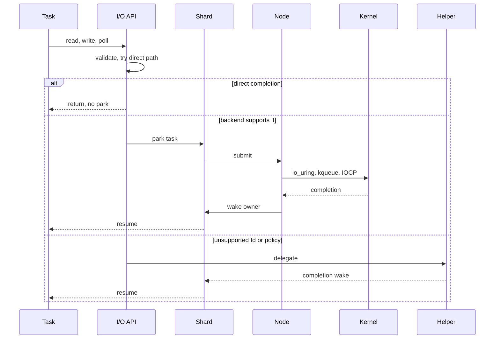

# I/O, blocking, and diagnostics

How task-facing I/O, blocking compensation, and diagnostics work inside the
runtime, and where the broker boundary sits.

## I/O nodes

Task-facing I/O looks blocking, but managed tasks park instead of pinning a
scheduler worker. Each call follows this shape:

1. Try a direct nonblocking path.
2. Cooperatively yield and retry when local work may produce readiness.
3. Use the direct blocking heuristic for short-lived operations.
4. Submit to the runtime-owned backend if supported.
5. Fall back to a blocking helper when the backend cannot own the operation.



Backends are runtime-owned:

- Linux nodes own `io_uring` state, CQE processing, and fd identity tracking.
- macOS nodes own kqueue readiness, `EVFILT_USER` wakes, and shared
  watch state. Darwin-only Mach hints stay behind Darwin guards.
- Windows nodes own IOCP ports, Winsock overlapped operations, HANDLE
  `ReadFile`/`WriteFile`, and version-specific batching policy.

On Linux, each `llam_node_t` owns an `io_uring` instance with a ring depth of 256. It
uses one-shot and multishot poll, accept, and recv, provided-buffer rings of 128
entries per node, and experimental SQPOLL. CQE processing identifies the owning shard
and re-enqueues the task.

On macOS, nodes use kqueue with `EVFILT_READ`, `EVFILT_WRITE`, and `EVFILT_USER` for
readiness and runtime wake signaling. Darwin also uses Mach ports (`semaphore_t`,
`mach_port_t`) for cross-thread wake when available.

On Windows, socket readiness policy stays conservative for stream `POLLIN` unless
explicitly enabled. Waitable HANDLE polling uses the platform wait path, because it
observes signaled handle state rather than socket readiness.

Linux and kqueue backends support multishot watches: one registered watch serves
multiple waiters, which avoids redundant kernel registrations for the same fd. Watch
tables track fd identity by `(dev_t, ino_t)` where the platform exposes stable
identity, to detect fd reuse.

Requests (`llam_io_req_t`) carry an atomic `wait_mode` that moves through
`NONE`, `SUBMIT_QUEUE`, `INFLIGHT`, or a `POLL_WATCH`, `ACCEPT_WATCH`, or `RECV_WATCH`
state until completion. An atomic `abort_reason` handles cancellation and timeout
races without locks.

Requests carry owner-runtime and owner-shard information so completions wake the
correct task. Close helpers such as `llam_close()` and `llam_close_handle()`
mark the runtime-local descriptor boundary before the platform close.

## Blocking compensation

`llam_enter_blocking()` and `llam_call_blocking_result()` keep foreign blocking
work from pinning scheduler progress. A shard-level opaque helper can take over
the local scheduler while the primary worker is in a blocking region. The
runtime-wide blocking pool handles explicit blocking jobs and reports completion
back to the owner runtime.

A shard creates its compatibility helper thread (`opaque_helper_thread`) on demand.
Registered managed runtimes use blocking callback offload instead of this handoff.
When a compatibility primary worker enters an announced blocking region:

```text
Primary worker:
  1. Increment opaque_compensation_depth
  2. Wake the helper thread
  3. Execute the blocking work

Helper thread:
  1. Wake and take over the shard's scheduler loop (opaque_scheduler_ctx)
  2. Run tasks from the shard's queues while the primary is blocked
  3. Relinquish control when the primary calls llam_leave_blocking()
```

Each runtime owns a separate pool of `block_worker_count` threads. Jobs queue through
that runtime's FIFO (`block_head`, `block_tail`) and move from `QUEUED` to `RUNNING`
to `FINISHED` or `ABORTED`. The connect fallback (`llam_blocking_connect_impl`) drives
a nonblocking `connect()` and `poll(POLLOUT, 10ms)` loop with `SO_ERROR` verification
in that pool rather than pinning a scheduler worker.

The [internal magic2 bridge](../magic2.md) uses that blocking pool for tagged
kernel and graph requests from managed tasks, preserving cancellation drain
and the existing execution-lease/P ownership boundary.

## Diagnostics

Runtime stats and dumps are architecture features, not add-ons. Dumps include
lifecycle state, stop flags, live tasks, active I/O waiters, blocking helper
state, node queues, processor scheduler-wake ownership, wait ownership, cancellation state,
handoff counters, and autotune state. Rare shutdown, cancellation, lost wakeup,
select fanout, blocking helper, and I/O ownership failures should be reduced
into focused direct runtime tests.

## Broker boundary

In-process public handles harden misuse, stale use, wrong-family casts, and
cross-runtime ownership mistakes. They are not a sandbox against code that can
read or corrupt the process memory.

The broker path is the isolation direction for hostile or memory-unsafe clients.
The broker owns runtime state, MAC keys, descriptors/HANDLE authority, grants,
revocation state, and private ring sessions outside the untrusted address space.
See [Security model](../../reference/security/index.md).
