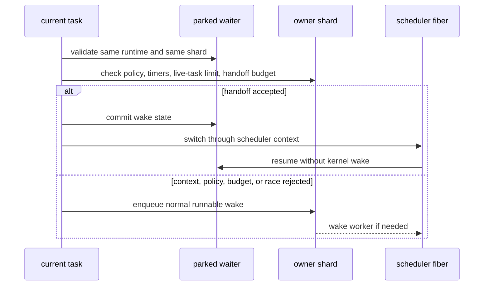

# Wakeups and watchdog

How a wake reaches a parked task, and how the 1ms watchdog keeps the runtime
moving.

## Wake handoff fusion

The normal wake path publishes a waiter as runnable, enqueues it on the owner
shard, and wakes a worker if needed. Wake Handoff Fusion is the faster same-shard
path used by latency-sensitive internal producers:

The optimization is intentionally bounded. `direct_handoff_budget` limits long
handoff chains, `direct_handoff_live_limit` avoids applying it to oversized
fanout, and timer guards keep timer-heavy workloads from being starved unless
the runtime explicitly allows timer overlap. Every rejected path falls back to
the ordinary wake/enqueue path.

Metrics split yield handoff and wake handoff attempts, hits, policy failures,
budget failures, no-work failures, push failures, and wake races. These counters
feed diagnostics and the watchdog-attached autotune governor.

This is the compatibility fast path. Registered managed execution returns through
its scheduler to preserve reservations and native continuation lifetime. The
runtime-local `direct_handoff_budget` starts from `LLAM_YIELD_DIRECT_HANDOFF_BURST`.

## Watchdog and autotune

The watchdog thread runs every 1ms (`LLAM_WATCHDOG_INTERVAL_NS`):

| Module | File | Function |
| --- | --- | --- |
| Probe | `watchdog_probe.c` | Detect stalled safepoints, measure queue pressure, and suspect deadlocks after 4 consecutive observations. |
| Scale | `watchdog_scale.c` | Scale up after 2 consecutive pressure observations and down after 12 consecutive idle observations, with a 4-tick cooldown. |
| Merge | `watchdog_merge.c` | Offline a shard by draining its queues and migrating tasks to a target shard. |
| Rehome | `watchdog_rehome.c` | Transfer ownership of parked waiters, in-flight I/O, submit-queue entries, and multishot watch state from an offline shard. |
| Autotune | `watchdog_autotune.c` | Rotate low-frequency metric windows and guard handoff-budget probes without running as a managed task. |

Rehome validates the entire waiter list before any migration. If one entry cannot be
rehomed, because of a pinned task or incompatible I/O state, the whole migration is
aborted to prevent partial ownership.

The 1ms watchdog is the safety loop. It checks safepoint progress, observes
queue pressure, scales dynamic workers when that experiment is enabled, pauses
and merges shards, and rehomes parked waiters or I/O ownership when a shard is
offlined.

Idle queues and an unchanged progress counter start a deadlock suspicion. Before
publishing `EDEADLK`, the controller uses a cold confirmation pass: it tries every
P lease lock and then every payload lock in P-ID order, checks runnable/native
service obligations, and verifies that every live G is parked on a mutex or join
owned by another G in the same parked set. Every dependency must belong to an
actual wait queue. A finite closed dependency set proves a cycle. Lock contention,
changed wait publication, unlisted work, or an incomplete scan produces an
inconclusive decision. The pass allocates before acquiring locks and never waits
for a scheduler worker or wait-object lock.

Wait snapshots retain the existing wait-resolver reference, which prevents node
and object reclamation while the controller reads them. Acquiring/releasing that
reference does not increment progress metrics. Completed handles and allocated
capsules can retain storage after execution has ended. The shared native adapter
separately checks capture/restore operations, gates, mailboxes, and retirement;
adapters without a precise snapshot defer deadlock confirmation while async
preemption is enabled. The bounded cold pass currently examines at most 64 Ps,
4,096 listed tasks including retained completed tasks, and 4,224 registered Ms;
larger or unstable snapshots remain inconclusive.

The opt-in Linux x86-64 async-preemption experiment can run across multiple
primary workers. Each started task stays affine to its first-dispatch worker
until its saved stack is retired. With dynamic workers enabled, the scaler may
offline only a fully empty worker with no async task or blocking-job service
obligations, and it never migrates queues or I/O ownership for this mode. A
started task prevents its worker from going offline even while the task is
parked or running a blocking callback. Queue pressure can reactivate an offline
worker; new tasks run only after that worker has passed the normal startup
qualification. Worker-ring mode cannot be combined with async preemption.
This path is experimental and is separate from native production qualification.

Autotune is attached to that watchdog thread, not implemented as a managed LLAM
task. It rotates low-frequency metric windows without allocation, blocking, or
user callbacks. Modes are:

- `off`: no governor.
- `observe`: publish sampled windows and decisions without changing policy.
- `on`: adjust the direct handoff budget through guarded probes.
- `frozen`: keep the published state stable for diagnostics.

The current actuator is the handoff budget. It probes only when the sampled
handoff data suggests the current budget is constraining useful handoff work.
Probe decisions require enough attempts and hits before commit; insufficient
traffic extends the probe instead of forcing rollback. Hard push/race failures
or an optional wake-latency p99 guardrail back the budget off.
