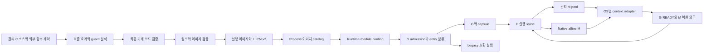
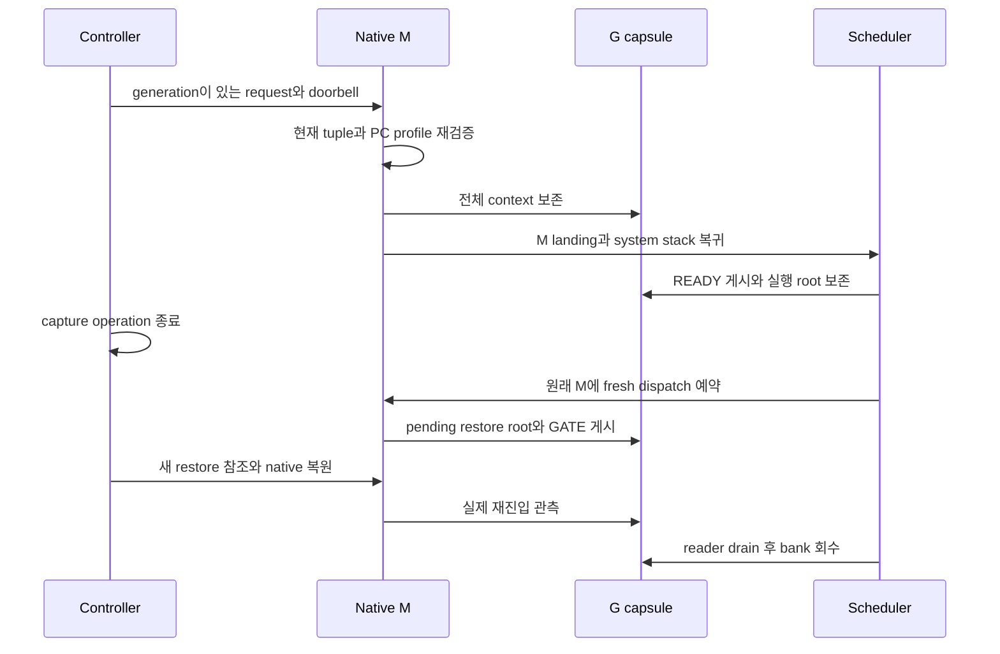

<!--
Copyright 2026 Feralthedogg
SPDX-License-Identifier: Apache-2.0
Licensed under the Apache License, Version 2.0 (the "License");
you may not use this file except in compliance with the License.
You may obtain a copy of the License at

    https://www.apache.org/licenses/LICENSE-2.0

Unless required by applicable law or agreed to in writing, software
distributed under the License is distributed on an "AS IS" BASIS,
WITHOUT WARRANTIES OR CONDITIONS OF ANY KIND, either express or implied.
See the License for the specific language governing permissions and
limitations under the License.
See LICENSE.
-->

# LLAM 3.0 비동기 선점 기본 실행 경로 설계

LLAM 런타임과 SDK 구현자가 일반 관리 태스크를 비동기 선점하는 주 실행
경로를 만들기 위한 설계다. 새 SDK로 검증한 C 코드에서는 사용자가
`yield`나 선점용 poll을 작성하지 않아도 CPU 독점 태스크 사이에 실행
기회를 배분한다. 런타임 임계구간과 외부 코드에는 명시적인 실행 계약을
적용한다.

상태는 **구현을 위한 설계안**이며 기준일은 2026-10-28 KST다. 아래의
새 타입·함수·파일명은 제안이다. 현재 공개 계약은
`include/llam/runtime.h`와 [ABI 문서](../../abi.md)가
정의한다. 구현 완료 여부는 이 문서의 단계별 검증 기준으로 판정한다.

이 문서에서 G는 사용자 태스크, M은 네이티브 OS 스레드, P는 큐·타이머
등의 실행 자원과 그 실행권을 가진 논리 프로세서다. M의 수명과 P의
대여 기간을 분리하는 것이 N:M 실행의 중심 계약이다.

## 목표와 결정

3.0의 새 관리 런타임은 다음 계약을 제공한다.

1. 검증된 관리 코드의 CPU 루프는 명시적인 LLAM 호출 없이 선점된다.
   일반 메모리 접근, 함수 호출, 재귀, 지원하는 SIMD 연산도 대상에 포함한다.
2. 태스크의 레지스터·스택·오류 상태를 보존하고, 같은 태스크를 동시에
   두 M에서 실행하지 않는다.
3. 정상적인 다중 워커, 대기·깨우기, I/O, 타이머, 외부 작업, 종료 경로가
   비동기 컨텍스트의 수명과 함께 동작한다.
4. 기존 공개 ABI 2.x의 레이아웃과 짧은 구조체 입력, 기존 생성 API의
   호환 동작을 보존한다. 새 관리 생성 API와 선점 설정은 ABI minor
   확장으로 도입한다.
5. 지원 OS 전체에 동일한 의미의 검증을 적용한다. 다른 OS의 통과나
   교차 컴파일 성공으로 네이티브 실행 결과를 대신하지 않는다.

아키텍처 결정은 다음과 같다.

| 결정 | 선택 | 이유 |
| --- | --- | --- |
| 일반 코드의 적격성 | LLVM 기반 관리 코드 계약과 최종 기계 코드 메타데이터 | PC 주소 목록만으로 호출·TLS·외부 잠금의 의미를 알 수 없다. |
| 기본 사용 경로 | 새 관리 생성 API의 `ASYNC_AUTO` | 기존 생성 API와 오래된 바이너리의 의미를 유지하면서 새 SDK의 기본값을 바꾼다. |
| 컨텍스트 저장 | G 소유의 두 bank와 독립된 복원 관측 | 다른 G를 캡처해도 이미 중단된 G의 상태를 덮어쓰지 않는다. |
| 비동기 복원 위치 | 캡처한 M과 binding incarnation | 네이티브 컨텍스트를 임의의 M으로 이동시키는 가정을 피한다. |
| P 실행권 | 기존 lease 저장소를 일반화한 단일 실행 lease | M registry와 P projection이 새로운 실행 권한을 만들지 않는다. |
| 네이티브 의존 태스크 | G 하나에 전용 M을 배정하고 P는 대여 | inline blocking이 다른 G의 복원 의무를 같은 M에 가두지 않는다. |
| 모듈 수명 | 등록 이미지 pin과 정지 상태의 해제 | 현재 PC뿐 아니라 스택의 반환 주소도 이미지 수명을 요구한다. |
| 모르는 상태 | 캡처 전 거부 또는 명시적 호환 동작 | 저장하지 못한 ISA 상태나 검증되지 않은 코드에 안전 표시를 붙이지 않는다. |

비동기 선점은 강제 취소와 별개다. 무한한 외부 호출을 종료시키거나 C
스택을 임의로 풀어 잠금을 해제하지 않는다. JIT 코드, 실행 중 text 수정,
임의의 C++ 예외·`longjmp`를 가로지르는 선점 계약, 완전한 비동기
컨텍스트의 cross-M 복원은 3.0의 필수 범위에서 제외한다. 이 기능을
사용하는 코드는 명시적인 호환·네이티브 계약으로 분류한다.

## 설계 작성 시점의 기반과 간격

이 표는 2026-10-28 설계 착수 시점이다. 이후 구현 상태는 아래의
구현 체크포인트와 [관리 런타임 안내](../../reference/managed-runtime.md)를 따른다.

| 영역 | 현재 확인한 기반 | 주 경로 승격에 필요한 변화 |
| --- | --- | --- |
| Linux x86_64 | signal 기반 캡처, G bank, 원래 M 복원, 다중 primary와 제한된 동적 워커 | 관리 코드 자동 등록, 여러 runtime의 process signal 공유, 일반 M/P 계약 |
| Linux ARM64 | signal frontend와 private 공유 프로토콜 | 다중 M, 일반 프로파일, 확장 컨텍스트 및 모듈·TLS 적격성 |
| macOS ARM64 | Mach 기반 캡처와 private 단일 primary 실행 | 다중 M/P, 일반 프로파일, ISA·SDK별 적격성 |
| Windows x86_64 | MinGW 경로, 고정 다중 primary, PE 인증 구간, 실제 복원·수명 검증 | 정식 SDK 연결, 공식 런타임 툴체인, 일반 M/P 및 외부 작업 통합 |
| macOS x86_64와 BSD | 일반 런타임의 플랫폼 지원 | OS별 네이티브 비동기 adapter와 공통 실행 검증 |
| 컴파일러 | 제한된 leaf 검증과 선택적 메타데이터, Win64의 별도 실험 emitter | 일반 관리 코드와 호출 효과, 최적화 이후 검증, ELF·Mach-O·PE 생성 |
| 로더 | private 등록과 범위 복사 | 이미지 발견·검증·pin·runtime 연결의 자동화 |
| 공개 정책 | `AUTO` 요청 정책과 별도의 실험 활성화 | 관리 생성 API, 실제 effective policy, 거부 이유와 자원 상태 |

근거는 [Phase 3](2026-09-09-phase3-async-context.md),
[Phase 7](2026-09-15-phase7-capability-policy.md),
[메타데이터 도구](../../tooling/preempt-metadata.md),
`src/core/context/async_context_shared.c`,
`src/core/context/windows_async_lifetime.c`에 있다.
`research/all-os-async-preemption-2026-10-26/artifacts/windows-recheck-20261027-results.json`의
26개 선점 케이스 통과는 해당 프로파일의 근거이며 전체 플랫폼의 주 경로
완료를 뜻하지 않는다.

## 실행 클래스

선점 정책과 네이티브 의존성은 별도 축이다. SDK는 진입 함수와 도달 가능한
호출의 효과를 분석해 entry descriptor를 만든다. runtime은 descriptor,
요청 정책, 실제 M의 적격성을 함께 검사한다.

| 클래스 | 허용 동작 | 배치와 선점 |
| --- | --- | --- |
| `MANAGED_PORTABLE` | 관리 메모리 연산, 관리 함수, LLAM 동기화·I/O, 명시적 offload | 일반 관리 M에서 실행한다. async snapshot은 원래 M에서 복원하고, 안전한 cooperative save 이후에는 이동할 수 있다. |
| `MANAGED_NATIVE_AFFINE` | 검증된 관리 구간과 명시적 네이티브 TLS·inline foreign 구간 | G의 수명 동안 전용 M을 유지한다. 관리 구간은 비동기 선점하고 foreign 구간에서는 P를 반납한다. |
| `LEGACY_COOPERATIVE` | 관리 메타데이터 없는 기존 코드 | 호환 실행 경로를 사용한다. `ASYNC_REQUIRED` runtime에서는 spawn 전에 거부한다. |

`MANAGED_PORTABLE`은 native TLS 주소를 보관하거나 네이티브 잠금을
소유한 채 관리 실행을 계속하지 않는다. 그런 효과가 도달 가능하면
entry를 `MANAGED_NATIVE_AFFINE`으로 분류하거나 컴파일을 거부한다.
효과를 증명할 수 없는 함수는 `auto` 빌드에서 legacy로 남고, `required`
빌드에서는 명시적인 계약을 요구한다.

기존 `PINNED`의 배치 선호를 네이티브 스레드 정체성 보장으로 바꾸지
않는다. native affinity는 descriptor와 별도의 새 spawn 정책으로
표현한다. 기존 `NO_PREEMPT`는 자동 선점을 제한하는 의도로 존중한다.
`ASYNC_REQUIRED`와 whole-task `NO_PREEMPT`의 조합은 `EINVAL`로 거부하고,
`ASYNC_AUTO`에서는 제외된 태스크 수를 조회할 수 있게 한다.

`ASYNC_AUTO`가 legacy 태스크를 허용하면 runtime의 effective policy는
`MIXED`다. 무한 legacy 루프에 대한 실행 기회나 종료 시간 보장은 이
프로파일에 포함하지 않는다. 모든 태스크의 관리 적격성이 필요한 서비스는
`ASYNC_REQUIRED`를 선택한다.

## 전체 구성



process catalog는 이미지와 signal namespace를 관리한다. runtime은
자기 G, M, P, 큐, quota와 종료를 소유한다. process 관리자나 module
binding이 P 실행권을 부여하지 않는다. runtime A의 종료는 A의 참조만
반납하며 B의 signal handler, 이미지 pin 또는 M을 해제하지 않는다.

## 반드시 유지할 불변식

| ID | 불변식 |
| --- | --- |
| I1 | G는 한 순간에 최대 하나의 M에서 사용자 코드를 실행한다. |
| I2 | P의 실행 owner는 단일 lease가 결정한다. snapshot·mirror·queue entry는 권한이 아니다. |
| I3 | 캡처는 live G/M/P tuple, 코드·ISA 적격성, zero unsafe depth를 모두 확인한다. |
| I4 | 중단된 G의 payload는 G가 소유하며 M의 다음 캡처가 덮어쓰지 않는다. |
| I5 | READY 게시 전에 G stack에서 벗어나고 실행 publication을 정리한다. |
| I6 | OS resume 성공과 실제 G 재진입 관측을 구분한다. bank 재사용은 관측과 reader 소멸 뒤에만 가능하다. |
| I7 | M과 module은 자신을 참조하는 실행·복원·최종 정리 의무가 끝날 때까지 살아 있다. |
| I8 | signal handler와 원격 target 정지 구간에서 할당·일반 잠금·사용자 callback을 실행하지 않는다. |
| I9 | inline foreign을 실행할 M에는 다른 G의 origin service 의무가 없어야 한다. |
| I10 | STOPPING은 새 admission을 닫되 이미 수락한 복원과 정리를 계속 서비스한다. |
| I11 | 세대 번호가 넘치면 새 admission을 거부한다. wrap 후 식별자를 재사용하지 않는다. |
| I12 | broker 격리와 in-process 오용 방어의 구분을 보존한다. 메타데이터는 악성 동일 프로세스 코드에 대한 sandbox가 아니다. |

## 관리 코드 컴파일 계약

### 지원할 일반 코드

관리 코드의 첫 정식 프로파일은 정수·부동소수점 연산, 일반 load/store,
고정 스택 프레임, 재귀, 관리 함수의 direct call, 검증된 함수 포인터
계약, 지원하는 SIMD와 C11 atomic 연산을 포함한다. C의 데이터 경합과
미정의 동작을 복구하지 않는다. native inline assembly, raw syscall,
가변 vector length 변경, 비지역 제어 이전은 별도 효과 계약을 요구한다.

G stack은 이동시키지 않는다. 따라서 GC용 포인터 재배치 지도를 요구하지
않는다. 대신 최종 PC 범위, frame·SP 조건, 호출 효과, native affinity,
필요한 machine-state profile을 검증한다. LLVM stack map은 instruction과
값 위치를 기록하는 기반이며 LLAM의 실행 안전성 계약을 대신하지 않는다.
[LLVM StackMaps](https://llvm.org/docs/StackMaps.html)

### 호출 효과

| 효과 | 처리 |
| --- | --- |
| `MANAGED` | 동일한 관리 ABI와 검증된 호출 계약을 적용한다. |
| `RUNTIME_CRITICAL` | runtime depth와 unsafe PC map으로 보호하고, 완료 뒤 요청을 다시 처리한다. |
| `FOREIGN_FAST` | 잠금·TLS 참조를 보유한 채 반환하지 않는 알려진 계약이다. 호출 중 선점을 지연한다. |
| `FOREIGN_BLOCKING` | 명시적 callback adapter를 통해 blocking pool로 offload한다. |
| `NATIVE_AFFINE` | 전용 M에서 실행하며 foreign enter 시 P를 반납한다. |
| `UNKNOWN` | `auto`는 entry를 legacy로 분류하고 `required`는 빌드를 거부한다. |

함수의 이름만으로 효과를 추측하지 않는다. libc와 외부 라이브러리의
계약은 버전이 있는 SDK 정의로 제공한다. 특히 잠금을 얻은 채 반환하는
함수는 단순한 `FOREIGN_FAST`가 될 수 없다. 모르는 함수를 호출하고
반환했다는 사실만으로 unsafe 상태를 지우지 않는다.

함수 포인터 typedef에는 가능한 호출 효과를 지정한다. `required` 모드의
indirect target은 등록된 entry descriptor 또는 명시적 foreign adapter와
일치해야 한다. 잘못된 function pointer나 선언한 계약과 다른 target은
프로그램 계약 위반이다. runtime이 임의의 반환값을 만들어 호출을 계속하지
않는다. 정상적인 자원·등록 오류는 G publication 전에 반환한다.

### Guard와 최종 코드 검증

guard는 명시적 부수효과와 memory effect를 가진 compiler intrinsic으로
표현한다. IR의 함수 annotation만으로 인증을 끝내지 않는다. register
allocation과 scheduling 이후의 verifier가 다음을 확인한다.

- unsafe 동작을 guard 밖으로 이동시키거나 guard를 제거한 경로가 없다.
- entry·exit·실패 분기에서 depth가 균형을 이룬다.
- prologue, epilogue, stack probe, 미완성 runtime publication은 필요한
  구간 전체가 unsafe로 표시된다.
- PC map은 실제 instruction boundary와 실행 section 안에 있다.
- 간접 분기, TLS, 호출 및 ISA 효과가 entry 계약과 일치한다.

처음에는 PC를 다시 실행하도록 고치는 restartable sequence를 인증하지
않는다. 지원 PC에서는 원래 PC로 정확히 복원한다. 최적화 프로파일별
negative test가 누락된 guard, 잘린 범위, 잘못된 effect와 링크 이후의
변형을 거부해야 한다.

Go runtime도 비동기 요청을 받을 때 사용자 G, M 상태와 stack 조건을
검사한다. 이 원칙은 참고하되 Go의 GC나 ABI 가정을 LLAM C 코드에
적용하지 않는다. [Go preempt.go](https://go.dev/src/runtime/preempt.go)

### SDK와 링크

`llam-clang`은 `off`, `auto`, `required` 관리 빌드 모드를 제공한다. 정식
SDK의 권장 경로는 `auto`이며, 서비스가 관리 실행을 필수로 요구하면
`required`를 선택한다. 사용자는 PC 시작·끝 주소를 수동으로 계산하지
않는다. 검증된 entry descriptor가 `llam_runtime_spawn_ex()`의 함수
주소와 연결된다.

지원 compiler·linker·CRT·최적화 조합을 fingerprint로 고정한다. 현재
`tools/preempt/patches/README.md`의 LLVM 23.1.2 Win64 실험은 bring-up
기준으로 활용하고, 정식 SDK는 별도의 qualification manifest를 가진다.
일반 IR plugin만 설치하고 late machine 검증이 수행됐다고 표시하지 않는다.

LTO, ICF, dead stripping, COMDAT, hot/cold 분할, tail call은 각각 별도
검증 대상이다. 초기 프로파일은 검증된 조합만 허용한다. 함수가 제거되면
그 메타데이터도 제거되고, 병합되는 코드는 효과와 모든 범위가 일치해야
한다. 지원하지 않는 링크 변환은 `required` 빌드 오류다.

### Native callback의 진입 경계

PC가 관리 함수 안에 있다는 사실만으로 현재 호출을 관리 G의 실행으로
판정하지 않는다. signal handler나 foreign callback이 관리 함수와 같은
본문을 호출할 수 있기 때문이다.

외부에 공개하거나 주소가 외부로 전달되는 함수에는 C ABI native entry
thunk와 숨겨진 managed body를 구분한다. native entry는 unsafe PC 구간에서
domain guard를 게시한 뒤 body를 호출한다. 이미 G를 소유한 runtime
dispatcher와 검증된 managed call만 descriptor의 managed entry로 들어간다.
metadata는 두 주소와 같은 함수의 효과를 연결한다.

native entry guard는 이전 domain과 TLS view를 보존한다. LLAM M 위의
native callback에서는 원래 G의 포인터만 보고 managed API를 실행하지
못하도록 한다. guard 획득 전과 해제 후의 thunk instruction도 unsafe로
표시한다. guard 자체는 해당 native context에서 할당·loader·일반 잠금
없이 실행할 수 있어야 한다.

native callback에서 같은 runtime의 작업을 동기적으로 기다리려면 별도의
callback bridge 계약이 필요하다. async notification은 새 G를 enqueue할
수 있지만, 중단된 G의 P를 붙잡은 callback이 그 P를 필요로 하는 새 G를
기다리는 동작은 거부한다. foreign call 안의 동기 재진입은 원래 M과
foreign token을 유지하며 외부 frame이 끝날 때까지 cooperative 경계만
사용한다. 관리 호출로 돌아왔다고 foreign frame의 제약을 지우지 않는다.

이 notification 허용은 정상 native callback context에 적용한다. 실제
OS signal handler에는 일반 spawn·wait API를 허용하지 않는다. signal에서
통지가 필요하면 사전 할당된 signal-safe bridge에 기록하고, 정상 host
context가 새 G의 admission과 enqueue를 수행한다. domain guard만으로
임의의 LLAM API가 async-signal-safe가 되는 것은 아니다.

thunk를 건너뛴 managed body 호출이나 guard를 가로지르는 `longjmp`·예외
전파는 관리 ABI 위반이다. `required`는 도달 가능한 이런 흐름을 거부하고,
`auto`는 관련 entry를 legacy로 분류한다. native handler가 관리 helper를
호출하는 상황도 compiler와 native 통합 테스트에 포함한다.

## LLPM v2 메타데이터

v2는 현재 v1 leaf 레코드를 자동 관리 실행의 증명으로 승격하지 않는다.
v1은 기존 expert 경로에서 계속 해석한다. 새 compiler가 v2 entry와
machine profile을 생성해야 자동 관리 실행에 사용할 수 있다.

| 레코드 | 필수 정보 |
| --- | --- |
| Image header | magic, major/minor, header/record 크기, endian, architecture, native ABI, managed ABI, 필요한 runtime ABI, required/optional flags |
| Build identity | compiler·linker profile ID, image build ID, 실행 section identity |
| Entry | native entry와 managed entry 주소, 코드 extent, 실행 클래스, 호출 효과, 필요한 ISA와 frame profile |
| PC map | 정렬된 반개구간, SAFE 또는 구체적인 UNSAFE 사유, frame·stack 조건 |
| Call contract | direct/indirect call 효과와 명시적 adapter/type ID |

레코드는 고정 폭 정수와 검증 가능한 상대 주소를 사용한다. runtime의
포인터 크기나 C struct padding을 파일 형식에 노출하지 않는다. 상대 주소
계산은 overflow를 검사하고 이미지 section 경계 안에서 해석한다. 큰
이미지를 위해 v2 주소 displacement는 64비트로 정의한다.

ELF는 `.llam.preempt`, Mach-O는 전용 read-only section, PE는 `.llampm`
계열 section을 사용한다. section 이름만으로 적격성을 인정하지 않는다.
entry 주소, 실행 권한, 이미지 ID, 중복·겹침, reserved bits, profile과
최종 기계 코드의 대응을 검사한다. 모르는 required flag와 ABI 조합은
`ENOTSUP`, 손상된 입력은 `EINVAL`로 거부한다.

PC map의 빈 구간은 unsafe다. source annotation과 build hash는 코드의
신뢰 경계를 설명하지만 적대적인 동일 프로세스가 text를 바꾸는 것을
격리하지 않는다. 등록한 text의 불변성은 실행 계약이다.

## 이미지 발견과 등록

### 자동 등록

관리 runtime의 host-side 준비 단계에서 실행파일과 이미 로드된 이미지를
발견한다. 각 이미지의 metadata를 검증하고 native loader reference를
확보한 뒤 immutable catalog snapshot을 게시한다. 사용자 G는 module
binding과 entry 적격성이 준비된 후에만 실행한다.

동적 모듈은 LLAM의 명시적 load/register wrapper가 native load를 완료한
뒤 등록한다. Windows `DllMain`이나 OS loader lock 안에서 runtime 잠금을
잡거나 worker 준비·drain을 수행하지 않는다. loader callback은 발견
알림만 남기고 실제 등록은 정상 host context에서 실행한다.

등록의 순서는 다음과 같다.

1. caller가 native image를 소유한 상태에서 LLAM이 겹치는 loader pin을 얻는다.
2. 이미지와 metadata를 검사하고 새 catalog snapshot을 완성한다.
3. runtime·module generation을 포함한 binding을 게시한다.
4. 게시에 성공하면 caller의 임시 참조를 반환할 수 있다.

실패하면 새 binding과 pin을 모두 회수하고 이전 catalog를 유지한다.
다른 runtime의 동일 이미지 등록은 독립된 runtime binding으로 허용한다.

### 읽기와 해제

handler는 dispatch 시 이미 pin된 immutable snapshot만 읽는다. catalog
mutex를 잡거나 loader·동적 TLS helper를 호출하지 않는다. 검색은 정렬된
interval index와 M-local 최근 구간 cache를 사용하고 반복 횟수를 제한한다.

3.0은 runtime이 사용하는 등록 이미지를 해당 runtime의 G와 native
service가 모두 끝날 때까지 pin한다. 현재 PC만 보고 해제하지 않는다.
다른 모듈의 함수를 실행 중이어도 stack의 return address가 원래 이미지를
가리킬 수 있다.

실행 중인 runtime의 module unregister는 `EBUSY`이며 catalog를 바꾸지
않는다. quiescent 상태에서 새 진입을 닫고 reader·G·request·capsule·M
참조를 확인한 후 handle을 소비한다. 마지막 process image reference가
사라질 때 정상 host context에서 native unload를 호출한다. live hot-unload와
JIT text 교체는 후속 기능으로 남긴다.

## 공개 API와 호환성

새 관리 경로는 기존 ABI에 추가하는 **ABI 2.2 제안**으로 제공한다. 제품
버전 3.0.0과 ABI major 2를 구분한다. 기존 enum 숫자, 공개 구조체 prefix,
오류·handle 소비 규칙을 유지한다.

다음은 구현 전 API 스케치다.

```c
typedef struct llam_preempt_opts {
    uint32_t policy;                 /* ASYNC_AUTO, ASYNC_REQUIRED, COOPERATIVE */
    uint32_t flags;                  /* unknown bits are rejected */
    uint64_t capsule_budget_bytes;   /* zero selects a documented profile */
    uint32_t native_affine_capacity; /* zero selects a documented profile */
    uint32_t reserved0;
} llam_preempt_opts_t;

int llam_preempt_opts_init(llam_preempt_opts_t *out, size_t out_size);

int llam_runtime_create_managed(
    const llam_runtime_opts_t *runtime_opts, size_t runtime_opts_size,
    const llam_preempt_opts_t *preempt_opts, size_t preempt_opts_size,
    llam_runtime_t **out);

int llam_runtime_preempt_info_ex(
    llam_runtime_t *runtime, llam_preempt_info_t *out, size_t out_size);

int llam_runtime_module_register_ex(
    llam_runtime_t *runtime,
    const llam_module_opts_t *opts, size_t opts_size,
    llam_module_t **out);

int llam_runtime_module_unregister(
    llam_runtime_t *runtime, llam_module_t *module);
```

`llam_module_t`는 runtime-owned opaque handle이다. 제안
`llam_module_opts_t`는 loaded image 안의 metadata 주소, 64비트 byte count,
32비트 flags와 reserved 필드를 가진다. 등록은 caller의 native image
reference가 살아 있는 동안 수행하고 LLAM이 독립된 loader pin을 얻는다.
OS가 확인한 이미지 경계와 section을 사용하며 임의의 heap blob을 실행
이미지의 인증서로 취급하지 않는다. 해제 성공은 handle을 소비하고
`EBUSY` 실패는 유효한 handle과 등록을 유지한다.

새 생성 API의 NULL 설정은 `ASYNC_AUTO`다. 기존
`llam_runtime_create()`와 process-default 초기화 호출은 기존 호환 정책을
유지한다. 새 SDK의 Quickstart와 기본 template은 관리 생성 API를 사용한다.
새 symbol을 쓰므로 구형 라이브러리가 REQUIRED 설정을 무시하고 성공하는
상황도 방지한다.

`preempt_mode`는 요청 시점을 결정하고 새 policy는 backend·admission을
결정한다.

| 요청 | 결과 |
| --- | --- |
| `OFF/COOPERATIVE`와 `ASYNC_REQUIRED` | 서로 충돌하는 설정으로 `EINVAL`을 반환한다. |
| 그 밖의 `OFF` | 자동 요청과 캡처를 사용하지 않는다. |
| 그 밖의 `COOPERATIVE` | 명시적인 cooperative 경계를 사용한다. |
| `AUTO/STRICT`와 새 policy `COOPERATIVE` | 기존 요청 정책을 유지하며 요청은 cooperative 경계에서 처리한다. async capture는 사용하지 않는다. |
| `AUTO/STRICT`와 `ASYNC_AUTO` | 적격 G는 비동기 선점하고 legacy G는 호환 경로를 사용한다. effective policy와 이유를 보고한다. |
| `AUTO/STRICT`와 `ASYNC_REQUIRED` | backend·ISA·entry 적격성을 요구한다. 실행 전 거부와 자원 부족을 오류로 반환한다. |

`STRICT`의 기존 진단 의미를 바꿔 unsafe 코드를 강제로 캡처하지 않는다.
`REQUIRED`는 실행 적격성 요구이며 모든 PC나 무한 foreign 호출의 강제
중단을 뜻하지 않는다.

모든 새 입력은 caller-size handshake, fixed-width 필드, 알려진 prefix
복사와 omitted-field 기본값을 사용한다. 알려지지 않은 flag는 `EINVAL`,
지원하지 않는 계약은 `ENOTSUP`, 자원 준비 부족은 `EAGAIN` 또는 `ENOMEM`,
소유 runtime 불일치는 `EXDEV`, live 설정 충돌은 `EBUSY`다. 실패 시
새 output handle은 NULL이며 부분 활성화를 남기지 않는다.

새 query는 requested/effective policy, backend와 profile ID, 등록된
managed/legacy entry 수, 제외된 G, 거부 이유, capsule charge와 native M
capacity를 반환한다. 제안 `llam_preempt_info_t`의 enum·state 필드는 32비트,
counter·byte count는 64비트이며 raw object pointer를 반환하지 않는다.
아직 native probe가 끝나지 않은 상태는 PREPARING으로 보고하고 ACTIVE로
표시하지 않는다. 기존 통계 struct와 JSON schema에 필드를 몰래
삽입하지 않는다. 필요한 통계는 크기 협상이 있는 새 구조체로 제공한다.

## M registry와 P 실행 lease

### 단일 실행 권한

현재 [Phase 1B](2026-09-09-phase1b-processor-resources.md)의 lease와 P
projection을 출발점으로 한다. lease 저장소와 `opaque_lock -> shard->lock`
순서는 우선 유지하고, owner를 embedded primary/helper 두 주소에서
runtime에 등록된 적격 M으로 일반화한다.

`P.current_owner`, M의 `current_p`, request의 P mirror는 각각 독립적인
grant를 만들 수 없다. 쓰기는 하나의 실행 lease 모듈을 통과하며 P
projection과 mirror는 같은 전이에서 갱신한다. legacy helper 함수는 이
모듈의 compatibility adapter가 된다.

v1과 일반화한 v2 프로토콜을 함께 빌드하는 동안 한 runtime은 시작 전에
하나를 선택한다. 같은 P에 두 프로토콜의 writer를 동시에 허용하지 않는다.
실행 중인 runtime의 authority mode 전환은 지원하지 않는다.

### M과 P의 분리

M registry는 stable slot, runtime owner, incarnation, native handle,
machine profile, system/landing stack, transport 상태와 service 의무를
보관한다. native thread ID만으로 M을 재식별하지 않는다. 실제 binding의
종료와 reader drain 뒤에만 slot을 다시 사용할 수 있다.

P는 큐·타이머·allocator·cache와 논리적 I/O 경로를 소유한다. G의
allocation owner, 현재 실행 P, timer owner와 attached I/O node는 별개다.
P가 다른 M에 대여되어도 이전 할당·completion의 소유권을 바꾸지 않는다.

| P 상태 | 허용 전이 |
| --- | --- |
| `FREE` | live·qualified M에 새로운 generation으로 grant |
| `OWNED` | 같은 owner의 실행·큐 접근 또는 명시적 revoke 준비 |
| `TRANSFERRING` | ordered locks 안의 중간 상태이며 외부 ticket으로 사용하지 않음 |
| `STOPPING` | 새 dispatch를 닫고 별도의 drain 권한만 허용 |
| `OFFLINE` | wake resource를 유지하며 새 사용자 실행을 허용하지 않음 |

grant는 runtime·P·M identity, binding incarnation, lease epoch, P generation과
online 상태를 함께 검증한다. queue access ticket은 참조나 실행권의 대체물이
아니며 사용 경계에서 재검증한다. M이 foreign 중이면 P fast path를 사용할
수 없다.

## G 상태와 M 서비스 의무

G의 cooperative context와 full async context를 구분한다. async capsule은
현재 P와 독립적으로 G에 속하고 다음 identity를 유지한다.

```text
runtime identity and run generation
G identity and dispatch generation
origin M slot and binding incarnation
capture dispatch tuple and bank generation
restore dispatch tuple and restore sequence
module catalog generation and machine profile
```

캡처 당시의 P generation은 캡처 권한 검증에 사용한다. 복원은 원래 M이
새로 얻은 현재 P lease를 검증한다. 과거 P epoch를 현재의 실행권으로
재사용하거나 현재 P가 달라졌다는 이유만으로 정상 복원을 버리지 않는다.

M service 의무에는 READY continuation, pending restore, native operation,
실행 중인 affine G와 최종 정리 reference가 포함된다. 이 의무는 M의
수명을 유지하지만 P를 계속 점유할 권한은 아니다. M은 P 없이 native
system context에서 대기할 수 있다.

G의 종료와 public handle의 소비는 capsule·stack의 즉시 회수 조건이
아니다. 기존 stale handle, active pin, consuming join/detach 계약을
보존하고 native reader까지 사라진 뒤 off-stack 회수를 완료한다.

## 요청과 캡처 프로토콜

controller는 deadline과 실제 runnable·timer·I/O pressure를 기준으로
대상을 선택한다. `STRICT` 진단 정책은 pressure 조건만 달리하고 안전
조건은 동일하게 적용한다.

1. ordered lease locks 아래에서 live G/M/P tuple을 얻고 필요한 참조를 잡는다.
2. bank와 request slot을 예약하고 immutable payload를 채운다.
3. request generation과 상태를 release 게시한 뒤 OS doorbell을 보낸다.
4. target은 acquire로 요청을 읽고 현재 tuple·PC·SP·ISA·unsafe depth를
   다시 확인한다. 보낸 쪽의 과거 검증만으로 실행하지 않는다.
5. 적격하면 G bank에 context를 보존하고 준비된 M landing 경로로 전환한다.
6. 원래 G stack을 벗어난 scheduler가 active-G를 정리하고 READY를 게시한다.
7. 짧은 capture operation 참조를 반환한다. G continuation과 service 의무는
   복원까지 유지한다.



signal은 깨우기 수단이며 실행 권한 자체가 아니다. 늦은 signal은 새로운
tuple을 위조할 수 없다. mailbox의 현재 요청을 처리하는 coalescing은
새 요청의 generation과 모든 admission 조건을 다시 확인할 때만 허용한다.

## Bank 전이와 복원

기존 C와 assembly가 공유하는 phase 숫자, 특히 `GATE` 값은 임의로
바꾸지 않는다. layout schema에서 C offset assertion과 각 assembler의
상수를 생성하고 동일한 검증에 넣는다.

| Phase | 소유권과 허용 작업 |
| --- | --- |
| `FREE` | 이전 reader와 pending descriptor가 없다. 새로운 generation으로 예약 가능 |
| `CAPTURING` | payload를 작성하는 단일 capture transaction이 소유 |
| `CAPTURED` | native 전환이 진행 중이며 아직 runnable로 공개하지 않음 |
| `READY` | G가 continuation을 소유한다. 남은 capture reader는 별도로 drain |
| `GATE` | 원래 M의 fresh scheduler save와 pending descriptor가 G를 유지 |
| `RESTORING` | native 복원이 commit됐으며 실제 재진입 관측을 기다림 |
| `OBSERVED` | 정확한 restore sequence의 실행을 확인했으며 reader가 끝나면 회수 가능 |

READY 게시 뒤에도 늦은 capture operation이 끝나지 않았을 수 있다.
GATE가 먼저 게시되는 경우를 지원하되, 이전 capture reader가 끝나기 전에
복원 payload를 바꾸지 않는다. M의 pending descriptor가 먼저 G를 유지한
뒤 새 restore 참조를 얻는다.

복원 성공은 `ResumeThread`, signal delivery 또는 `SetThreadContext` 반환값으로
판정하지 않는다. 정확한 G stack과 restore dispatch에서의 재진입 또는
그 실행의 실제 scheduler return을 witness로 사용한다. 이미 OBSERVED인
옛 bank를 이후 cooperative dispatch의 generation과 다시 비교해 실패시키지
않는다.

사용자 poll이 없는 CPU 루프의 witness도 native adapter가 제공해야 한다.
별도의 read-only 관측은 원래 binding, 정확한 restore dispatch, G stack과
현재 실행 domain을 확인한다. restore gate나 nested native callback에
머문 상태는 재진입 증거가 아니다. 읽기 전용 witness는 새 capture를
허용하는 SAFE PC 판정과 구분하고, context를 변경하지 않는다.

다음 capture 관측으로 이전 복원의 witness를 확정할 수 있지만, 두 작업의
request kind와 소유 참조는 구분한다. 두 bank 모두 reader가 유지 중이면
새 capture를 지연하고 controller가 기존 관측·reader drain을 먼저 진행한다.
저장소를 강제로 재사용하거나 witness를 만들어 진행시키지 않는다.

동일 M에서 G1이 READY인 동안 G2도 실제로 캡처할 수 있어야 한다. 전역
resume PC, M 하나의 영구 capture slot, 이전 G가 끝날 때까지 다음 캡처를
막는 구조는 허용하지 않는다.

## 원자적 게시와 잠금 순서

normal context는 lease lock 뒤 payload lock을 얻는다. 여러 P가 필요한
작업은 안정된 P ID 순서로 모든 lease lock을 얻은 뒤 같은 순서로 payload
lock을 얻는다. capture·restore native transaction 동안 이 잠금을 유지하지
않는다. 그 사이의 수명은 별도 참조와 generation으로 보장한다.

| 게시 대상 | 순서 |
| --- | --- |
| request | payload 완성 → release 상태 게시 → doorbell |
| signal mirror | 단일 writer가 sequence를 odd로 바꿈 → release fence → atomic 필드 작성 → even release 게시 |
| handler snapshot | even acquire 읽기 → atomic 필드 읽기 → acquire fence → 같은 even 값 재확인; 실패 시 제한된 시도 후 defer |
| READY | context와 off-stack 상태 완성 → release READY → queue publication → wake |
| GATE | pending G root 확보 → restore identity 작성 → assembly gate release |
| bank 회수 | 실제 witness → reader zero → pending pointer 철회 → FREE release |

signal frontend가 사용하는 atomic은 해당 target에서 lock-free임을
build와 startup probe로 확인한다. 128비트 CAS나 lock을 내부적으로 쓰는
atomic helper를 전제하지 않는다. 요청 generation은 수명 참조를 대체하지
않으며 seq_cst 한 번으로 여러 필드의 소유권을 증명하지 않는다.

mirror의 payload 필드도 lock-free atomic이다. plain C 필드의 동시 접근을
sequence 재검사만으로 안전하게 만들지 않는다. payload의 relaxed 접근은
위 fence와 sequence 게시를 모두 갖춘 경우에만 사용한다. sequence wrap은
binding을 재사용하는 근거가 될 수 없고, snapshot에 담긴 object의 수명은
별도의 참조가 유지한다. 같은 M의 writer가 signal로 중단되면 handler는
odd 값을 기다리지 않고 defer한다. ARM64의 약한 메모리 순서를 포함한
litmus와 실제 native stress로 이 게시 프로토콜을 검증한다.

## 스케줄러와 워커 증감

### Runnable 저장소

일반 큐에는 NEW G와 이동 가능한 cooperative continuation을 저장한다.
ASYNC READY는 G의 origin M을 대상으로 하는 service queue에 저장한다.
ready entry는 필요한 수명 참조를 소유하고 단 한 번 소비된다. 취소와
중복 wake가 같은 entry를 두 번 enqueue할 수 없다.

work stealing은 NEW G와 검증된 cooperative continuation에 적용한다.
다른 P가 async resume 작업을 선택할 수는 있지만 실제 복원 M은 바꾸지
않는다. 필요하면 P lease를 그 M에 대여한다. 완전한 async payload를
일반 `G.ctx`로 해석하거나 다른 M에 dispatch하지 않는다.

관리 G가 정상적인 LLAM 경계에서 새 cooperative context를 저장하고 모든
이전 bank·native operation·pending restore를 정리한 경우에만 이동 가능
상태로 바뀐다. native-affine G는 이 경우에도 M에 남는다.

### 공정성과 지연

controller는 M별 요청 세대, deadline, 거부 사유와 재시도 시점을 유지한다.
한 M의 늦은 응답이 다른 M의 요청 큐를 막지 않도록 라운드별 처리량을
제한한다. Windows 원격 transaction은 우선 기존의 직렬 실행을 유지한다.
그 비용이 검증 기준을 넘으면 독립 binding별 병렬화가 별도 변경 과제가 된다.

큐 pop과 active-G 게시 사이에는 M이 소유하는 dispatch reservation이
존재한다. reservation은 G 수명을 유지하며 signal에는 unsafe로 보인다.
P payload lock을 놓기 전에 게시하고 active-G publication이 끝난 뒤
반납한다. 큐에서 사라진 G가 실행 중도 대기 중도 아닌 것으로 관측되는
틈을 만들지 않는다.

초기 정식 async 프로파일은 full context의 정리 경계를 우회하는 direct
G-to-G handoff를 사용하지 않는다. 이후 재도입은 양쪽 G가 cooperative
상태이고 native reader·bank·module 전이가 없다는 동일한 검증을 요구한다.

### 동적 M과 P

새 관리 M은 native binding, system/landing stack, signal 또는 context
adapter, ISA profile을 준비하고 실제 왕복 probe를 통과한 뒤 공개한다.
기존 M과 같은 OS라는 이유로 검증을 생략하지 않는다.

offlining은 새 배치를 닫은 뒤 큐·timer·I/O-route 전이를 준비하고,
해당 M의 service 의무가 zero인지 확인한다. 다른 G의 bank가 남아 있으면
M을 유지한다. 무한 G를 실행 중인 M을 강제로 없애는 것은 scaling 계약에
포함하지 않는다. 증가와 빈 worker의 감소는 기본 프로파일에서 지원한다.

P가 offline이 되어도 wake descriptor를 즉시 닫지 않는다. 기존 Phase 1B의
정지·재활성화·종료 소유권을 유지하며 allocator owner와 attached I/O node를
자동으로 재지정하지 않는다.

## 외부 호출과 네이티브 의존성

### 일반 관리 태스크

`MANAGED_PORTABLE`의 blocking 호출은 명시적인 callback adapter로
offload한다. generated adapter는 인자·반환값의 ABI를 알고 있어야 하며
호출자 TLS나 잠금 소유권을 복사한 것처럼 동작하지 않는다. 무작위 C
호출을 자동으로 다른 스레드에 옮기지 않는다.

G는 callback이 실제로 끝나고 인자 참조가 정리될 때까지 park한다.
timeout이나 cancel만으로 G stack의 인자 버퍼를 해제하지 않는다.
queued 취소와 running 취소를 구분하고, admission ticket은 job의 마지막
정리에서 반환한다. blocking callback의 네이티브 재진입은 생성한 callback
bridge와 기존 outside-task API 계약을 따른다.

짧은 `FOREIGN_FAST` 호출은 guard로 보호한다. 호출의 긴 지연은 unsafe
duration과 요청 지연에 포함해 관측한다. I/O나 명시적 대기를 이런 범주로
숨기지 않는다. page fault나 OS 스케줄링 지연까지 제거하는 실시간 보장은
제공하지 않는다.

### Native affine 태스크

native TLS나 inline foreign의 효과가 있는 관리 entry는 첫 사용자
instruction 이전에 전용 M을 얻는다. 그 M은 G가 끝날 때까지 다른 사용자
G를 실행하지 않는다. 따라서 foreign 진입 시 같은 M에 다른 G의 중단
컨텍스트가 남는 상황을 배치 단계에서 차단한다.

```text
G1 on M1 with P0
    async capture -> M1 system stack -> G1 READY -> release P0
G2 on M2 acquires P0 and runs
    P0 later returns to M1 -> G1 restores on M1

G1 enters inline foreign on its exclusive M1
    retire prior native operations -> publish foreign token -> release P0
    native call continues on M1 without P
G2 on M2 acquires P0 and runs
    G1 returns -> fresh P claim -> validate token -> resume managed G1
```

`llam_enter_blocking()`의 새 관리 경로는 다음 순서를 따른다.

1. entry의 native-affine 계약과 전용 M 배치를 확인한다.
2. 현재 G의 이전 복원을 witness로 확정하고 old reader를 정리한다.
   native operation, pending restore와 다른 G service 의무가 남아 있으면
   아직 foreign 코드를 실행하지 않는다.
3. G/M/P tuple을 검증하고 기존 lease 전이와 foreign token을 게시한다.
4. P를 반납한 상태로 동일 native M에서 caller의 foreign 코드를 실행한다.
5. leave에서 새로운 P lease를 얻고 같은 token·binding·G generation을
   검증한 뒤 managed publication을 복원한다.

중첩 enter/leave는 같은 token의 depth만 바꾼다. 현재
[Phase 2](2026-09-09-phase2-foreign-detach.md)의 반환·STOPPING unwind·오류
계약을 유지한다. portable entry에서 선언하지 않은 inline foreign 호출은
compiler `required` 오류이며, runtime의 검사는 부수효과 이전에 거부한다.

native-affine capacity는 별도 credit으로 제한한다. startup 이전 spawn은
M slot과 필요한 자원을 예약하고, 실제 M 준비 실패는 사용자 G를 하나도
실행하지 않은 startup rollback으로 처리한다. 실행 중 spawn은 이미
qualified된 idle M을 확보할 수 없으면 publication 전에 `EAGAIN`을 반환한다.
controller의 cold path가 설정된 한도 안에서 spare M을 준비한다.

legacy와 async-capable G를 같은 M에서 무조건 섞지 않는다. 호환 M은
legacy continuation을 처리하고, async M은 관리 G를 처리한다. 두 종류
모두 P lease를 사용한다. `ASYNC_REQUIRED`에는 legacy G를 admission하지
않는다.

## 레지스터와 스레드 상태

native context 형식은 adapter가 소유한다. 공통 scheduler가 Linux
`ucontext_t`를 Windows CONTEXT나 Mach thread state로 변환하지 않는다.

| 상태 | 소유권과 복원 원칙 |
| --- | --- |
| GPR, PC, SP, flags | G continuation의 정확한 값과 해당 PC의 stack 조건을 보존 |
| FP, SIMD, XSTATE, SVE 등 | worker가 검증한 profile의 모든 live 상태를 보존; 저장하지 못하는 상태는 캡처 전에 거부 |
| `errno`, Windows `LastError` | 같은 M의 첫 전환 경계에서 G 상태와 scheduler 상태를 교환 |
| native TLS base, OS thread identity | M 소유; G context를 복원한다고 다른 M의 native base를 덮어쓰지 않음 |
| LLAM task-local 값 | G 소유이며 기존 API 의미 유지 |
| signal mask와 altstack | backend 계약에 따라 저장·복원하며 예약 signal의 소유권을 별도로 유지 |
| CPU 보안·제어 상태 | 명시적으로 지원하는 상태만 취급; OS 정책을 몰래 낮추거나 비활성화하지 않음 |

원격 controller가 다른 M의 CRT TLS를 자기 TLS처럼 읽지 않는다. native
register 저장과 별도로, target-side landing·restore 경계가 오류 상태를
처리한다. scheduler 함수를 호출하기 전에 원래 G의 오류 값을 보존하고
G 재개 직전에 돌려놓는다. Windows의 CRT 조합도 qualification profile에
포함한다.

Linux CET shadow stack은 별도의 반환 주소와 signal-return 검증을 가진다.
단순히 RIP/RSP를 복사했다고 지원 상태로 표시하지 않는다.
[Linux CET 계약](https://docs.kernel.org/arch/x86/shstk.html)

Linux ARM64 SVE record는 vector length와 live payload 여부에 따라 달라지고,
signal return의 VL 조건도 존재한다. parser는 header-only와 live record를
구분하고, 지원하는 상태를 손실 없이 복원해야 한다. SVE/SME·EXTRA record를
모르는 경우 허용 비트만 넓혀 통과시키지 않는다.
[Linux SVE 계약](https://docs.kernel.org/arch/arm64/sve.html)

stack guard, red zone, Win64 shadow space, unwind 정보, PAC·shadow stack 등은
각 native ABI profile의 입력이다. 단일 SP alignment 상수로 모든 instruction
위치를 판정하지 않는다. landing stack은 C ABI를 만족하도록 따로 준비한다.

native affinity는 TLS base, vector length, CET·보안 profile을 임의로 바꿀
권한이 아니다. 이런 profile 변경은 모든 저장된 continuation과 binding을
정리한 뒤 재검증하는 별도 작업이다. G의 일반 FP rounding·exception
상태는 지원 profile 안에서 G 상태로 보존한다. live runtime을 상속한
`fork` child에서 기존 binding을 재사용하지 않으며, 관리 실행 중의
`fork/exec`는 별도 quiescence 계약 없이는 지원하지 않는다.

## Process signal과 native binding 관리

signal backend는 process-wide namespace manager를 공유한다. 기존
`llam_signal_set_*`과 같은 signal을 동시에 소유할 수 없으며, 첫 owner가
정상적인 이전 disposition을 보존하고 마지막 owner가 자신이 여전히
소유하는 action만 복원한다.

handler는 native thread binding과 runtime run generation을 통해 요청을
찾는다. 한 runtime의 stop이 process handler 전체를 끄지 않는다. 이미
존재하는 action, 막힌 예약 signal, 부적합한 altstack은 실제 M의 startup
probe에서 확인한다.

동적으로 로드한 shared library에서도 handler가 `__tls_get_addr` 같은
loader 경로를 호출하지 않도록 한다. 다음 둘 중 검증한 접근만 사용한다.

- startup에 고정된 signal-safe TLS 접근 모델.
- native TID와 incarnation으로 조회하는 preallocated process binding
  table. handler는 제한된 atomic read만 수행하며 entry 수명은 owning M의
  signal 차단·drain·unbind 순서가 보장한다.

thread ID 재사용과 늦은 signal은 binding incarnation 및 request tuple로
구분한다. close는 sender를 닫고 reader를 drain한 뒤 owning M에서 예약
signal을 차단·배출하고 native thread를 종료한다.

handler 안에서는 allocator, 일반 pthread lock, loader, stdio, 사용자
callback을 사용하지 않는다. POSIX의 async-signal-safety와 오류 상태
보존 요구를 해당 adapter의 구현 기준으로 적용한다.
[POSIX sigaction](https://pubs.opengroup.org/onlinepubs/9799919799/functions/sigaction.html)

## Windows와 Mach 원격 transaction

원격 adapter는 준비, native 정지, 관측·수정, 재개, normal-context 정리의
단계를 구분한다. suspend는 일반 LLAM 동기화 수단으로 사용하지 않는다.
Microsoft는 suspend된 스레드가 소유한 동기화 객체를 호출자가 기다리면
교착할 수 있음을 명시한다. 따라서 native 정지 구간에 들어가기 전에
할당, 이미지 pin, lock 획득과 필요한 API 준비를 끝낸다.
[SuspendThread](https://learn.microsoft.com/en-us/windows/win32/api/processthreadsapi/nf-processthreadsapi-suspendthread)

Windows는 자신이 증가시킨 suspend count만 반납한다. 외부 suspend를
강제로 해제하지 않는다. Get/SetThreadContext는 정지한 올바른 native
binding에 적용하고, OS가 통제하는 상태를 임의 값으로 복원하려 하지
않는다. 동일 M의 native transaction은 하나만 진행한다.
[GetThreadContext](https://learn.microsoft.com/en-us/windows/win32/api/processthreadsapi/nf-processthreadsapi-getthreadcontext),
[SetThreadContext](https://learn.microsoft.com/en-us/windows/win32/api/processthreadsapi/nf-processthreadsapi-setthreadcontext)

Mach에서도 LLAM이 소유한 suspend 증가와 thread port reference를 각각
기록한다. 다른 제어자의 suspend count를 추측해 zero로 만들지 않는다.
외부 debugger나 profiler가 LLAM 소유의 native context를 동시에 바꾸는
실행은 별도 통합 계약을 요구한다.

| 실패 시점 | 처리 |
| --- | --- |
| native 상태 변경 전 | 요청 거부 또는 안전한 재시도, 정확한 참조 반환 |
| suspend만 얻었고 context 변경 전 | LLAM이 얻은 suspend만 반납하고 거부 |
| native context 변경 후 rollback이 검증됨 | 원상복구와 참조 drain을 확인한 후 실패 반환 |
| commit 여부나 복원 상태가 불명확 | hosting process fail-fast; 성공·cooperative fallback으로 위장하지 않음 |
| 지원하지 않는 시작 profile | 사용자 G dispatch 전 `ENOTSUP` 또는 AUTO의 명시적 호환 전환 |

정식 managed API의 이 실패 정책은 공개 계약에 포함한다. 기존 Windows
expert API의 caller certification과 acknowledgement 규칙도 보존한다.

## 메모리와 admission 예산

첫 정식 구현은 이미 검증한 두-bank 소유권을 유지한다. capture handler의
lazy allocation이나 한 M의 단일 저장 버퍼를 여러 G가 공유하는 최적화는
채택하지 않는다.

```text
charge(G) = bank header와 alignment
          + 2 × 해당 runtime의 qualified context capacity
          + G별 native service metadata

runtime capsule charge = 수락한 모든 G의 아직 반환되지 않은 charge 합
```

예산에는 CAPTURED/READY/RESTORING뿐 아니라 준비 중인 allocation과 terminal
reader가 유지하는 저장소도 포함한다. public handle이 완료됐다는 이유로
charge를 먼저 반납하지 않는다. allocator retention, G stack, M stack과
사용자 버퍼는 별도로 보고한다.

host-side spawn은 publication 전에 quota와 backing storage를 확보하고
필요한 페이지를 준비한다. managed spawn의 fast path는 준비된 pool을
사용한다. cold refill을 기다려 scheduler M을 막는 대신 publication 전
`EAGAIN` 또는 `ENOMEM`으로 반환할 수 있어야 한다. 거부한 G를 실행하거나
REQUIRED G를 조용히 cooperative로 바꾸지 않는다.

현재 64 MiB 값은 bring-up 기준으로 사용한다. 정식 profile의 기본값은
지원 ISA별 context 크기와 실제 G 규모 측정으로 결정한다. 이 값은 RSS
상한이 아니며 사용자 메모리를 포함하지 않는다. 다음 식으로 설정이
허용하는 최대 동시 G 수를 사전에 계산·노출한다.

```text
maximum charged G count <= capsule budget / conservative per-G charge
```

single-bank, G stack 안의 저장 frame, demand commit은 후속 최적화 후보다.
기본값 승격에 필요한 성능을 두-bank 방식이 충족하지 못하면 별도
소유권·재진입 검증을 거쳐 선택한다. 현재 설계의 예산을 숨기기 위해
저장 상태를 줄이지 않는다.

## I/O와 대기 경로

비동기 선점은 기존 waiter·completion의 owner를 바꾸지 않는다.

- capture 중에는 G를 runnable 큐와 wait 큐 양쪽에 게시하지 않는다.
- park 경계에서는 현재 실행 publication을 정리하고 기존 wait generation과
  resolver ownership을 확정한 뒤 native 정리와 연결한다.
- completion은 기존 node·request owner를 따라 전달하며 새로운 실행 P와
  allocation owner를 혼동하지 않는다.
- cancel, timeout, close가 경합해도 wake와 cleanup의 승자는 하나다.
- callback과 I/O가 G stack 또는 owned buffer를 참조하면 실제 completion과
  마지막 reference drain 전까지 그 저장소를 유지한다.

기존 public handle의 family, seal, owner와 active pin 검증을 모든 새
API에도 적용한다. 내부 raw G 포인터가 public ABI가 되는 경로는 만들지
않는다. 다른 runtime의 completion이나 stop 요청은 `EXDEV` 경계를 넘지
못한다.

## 시작과 종료

### 시작 barrier

managed runtime은 native binding별 검증 결과를 모은 뒤 한 번의 run
commit으로 사용자 dispatch를 연다. layout·signal·TLS·machine profile
probe는 실제 실행할 M에서 수행한다. probe 전용 요청은 사용자 capture
요청과 다른 종류이며 G/P 실행 권한을 우회할 수 없다.

일부 M의 생성이나 probe가 실패하면 아직 사용자 코드를 실행하지 않은
상태에서 barrier를 해제하고 준비 자원을 회수한다. NEW G가 controller
drain을 무한히 유지하지 않도록 한다. REQUIRED는 실패를 반환한다. AUTO의
호환 전환은 사용자 실행과 async commit이 시작되기 전에만 허용하며
effective policy와 이유를 남긴다.

### 종료 drain

종료 순서는 다음과 같다.

1. 새 G·module 변경·offload admission과 일반 capture 요청을 닫는다.
2. 이미 수락한 G의 READY·GATE·RESTORING과 completion을 계속 서비스한다.
3. 살아 있는 실행에는 기존 cancellation 의미를 전달한다. 필요하면 별도의
   STOPPING drain 권한으로 실행 기회를 제공한다.
4. native operation, pending restore, bank reader, callback과 finalizer를 정리한다.
5. M의 native binding과 stack을 닫고 thread를 join한다.
6. P·I/O node·allocator·module binding·runtime 저장소를 기존 owner 순서로 해제한다.
7. 마지막 process owner가 shared signal과 이미지 pin을 반환한다.

일반 execute ticket을 STOPPING에서도 유효하게 만드는 방식은 사용하지
않는다. drain ticket은 이미 수락한 실행의 마무리에만 쓰인다. peer runtime은
독립된 admission과 참조를 유지한다.

drain 중에도 마무리에 필요한 capture와 restore는 별도 권한으로 서비스한다.
일반 capture admission을 닫았다는 이유로 이미 실행 중인 G가 다른 G의
정리 기회를 영구히 차지하게 두지 않는다. 동일한 PC·tuple·수명 검증은
drain 요청에도 적용한다.

비동기 선점은 arbitrary C frame에 cancellation exception을 주입하지 않는다.
실행이 끝나지 않는 G나 foreign callback이 있으면 기존 destroy가 기다릴 수
있다. 별도 timed shutdown API를 추가할 경우 timeout 후 runtime과 handle은
계속 살아 있어야 하며, timeout을 회수 완료로 보고하지 않는다.

## Liveness와 deadlock 판정

큐가 비었고 metric이 잠시 증가하지 않았다는 사실만으로 fatal deadlock을
판정하지 않는다. cold confirmation은 다음 의무를 함께 확인한다.

- M의 dispatch reservation과 active G.
- READY bank, pending gate, native operation과 restore witness.
- foreign M, blocking job ticket, I/O와 timer callback.
- task finalizer와 public/scan pin.
- unmanaged host가 깨울 수 있는 channel·condition wait.

확인 중 publication epoch가 바뀌거나 M이 정지 확인에 응답하지 않으면
결과는 inconclusive다. 관측·진단 자체를 progress로 세지 않는다. 실제로
막힌 내부 mutex 순환 같은 확정 가능한 경우만 기존 fatal 정책으로 연결한다.

테스트는 queue pop 전후, active-G 게시 전후, park publication, READY 인계,
witness와 DEAD 최종 정리 사이에 실제 실행을 멈춰 이 규칙을 검증한다.
시간 제한을 늘리거나 가짜 progress를 넣어 오탐을 숨기지 않는다.

## 플랫폼과 툴체인

모든 행은 각각의 native 실행 gate가 필요하다. 현재 일반 런타임의 지원을
새 async profile의 지원으로 자동 승격하지 않는다.

| Target | Adapter 방향 | 필수 qualification |
| --- | --- | --- |
| Linux x86_64 | thread-directed signal과 Linux의 실제 signal-return 경로 | legacy FP/XSAVE, signal namespace, 지원 CET·PKRU 정책, multi-runtime |
| Linux ARM64 | signal mailbox와 fresh native signal frame | FPSIMD·SSBS, SVE/SME record 정책, vector length, static/dynamic library binding |
| macOS ARM64 | Mach thread state와 원래 M restore gate | GPR·NEON·FP 제어, PAC/opaque state·SME 정책, suspend 및 port 수명 |
| macOS x86_64 | XNU x86 native context adapter | x86 state flavor, SIMD 확장, stack/red-zone, Mach 소유 suspend |
| Windows x86_64 | native context adapter와 compiler-qualified PE | Win10/Win11, CRT, XSTATE·mitigation 정책, 원래 M 복원과 loader pin |
| FreeBSD x86_64 | 해당 kernel ABI의 signal adapter | 실제 context record, signal return, thread delivery와 namespace |
| OpenBSD x86_64 | 해당 kernel ABI의 signal adapter | 해당 OS가 허용하는 context 변경·복원과 보안 정책 |
| NetBSD x86_64 | 해당 kernel ABI의 signal adapter | LWP binding, native context와 pending signal 수명 |
| DragonFly BSD x86_64 | 해당 kernel ABI의 signal adapter | native context·TLS·worker 종료와 release artifact gate |

BSD에 Linux frame layout을 복사하지 않는다. 불충분한 ABI나 보안 기능
지원은 새 native 증거가 생길 때까지 미지원으로 보고한다. 어떤 플랫폼을
3.0의 완전한 주 경로 목록에서 제외하려면 제품 지원 범위를 명시적으로
바꿔야 하며, 테스트 SKIP으로 완료 판정을 대신하지 않는다.

관리 SDK의 기준 compiler는 검증된 LLVM 계열로 통일한다. Windows는
Clang의 Microsoft ABI 경로와 runtime의 MSVC 빌드 조합을 정식 대상으로
검증하고 MinGW 조합도 별도 profile로 유지한다. 순수 MSVC client object는
관리 metadata backend가 검증되기 전까지 legacy로 분류한다.

runtime 자체를 MSVC로 빌드하는 것과 client 코드에 관리 metadata를 생성하는
것은 별도 capability다. Windows assembly bridge는 공통 layout schema에서
GNU/MASM 상수를 생성하고 양쪽 C context와 검증한다. 현재 `NOT MSVC`
조건을 제거하는 작업에는 이 ABI·assembly·atomic 검증이 포함된다.

LLVM plugin, patched codegen 도구가 필요한 초기 SDK, linker와 verifier는
독립된 도구 패키지로 배포한다. core runtime 저장소에 전체 LLVM 소스와
중복 설치본을 넣지 않는다. toolchain manifest는 버전·패치·hash·target·link
profile을 기록하고 잘못된 조합은 빌드 초기에 거부한다.

## 정확성 검증

assembly leaf는 transport 검증으로 유지한다. 일반 관리 코드 지원은
별도의 C 프로그램으로 증명한다.

| Gate | 통과 조건 |
| --- | --- |
| 일반 C | load/store, 호출 chain, 재귀, local array, atomics, 지원 SIMD를 포함한 no-yield 계산의 정확한 결과 |
| 공정성 | 모든 worker를 점유한 CPU G가 있어도 peer, timer, I/O와 control 작업이 실제로 실행됨 |
| 같은 M의 겹침 | G1이 READY인 상태에서 G2도 캡처되며, G2의 자연 종료를 기다린 성공으로 대체하지 않음 |
| context | 모든 지원 register·FP·flags·오류·mask 상태의 exact restore |
| 수명 | stale generation, 늦은 signal, 취소, close, stop, destroy 후 UAF·중복 resume·누수 없음 |
| M/P | work stealing, native-affine M, helper·foreign 반환과 scaling에서 단일 P owner 유지 |
| module | 잘못된·겹친·제거된 metadata 거부, active 이미지 unload `EBUSY`, 마지막 pin 정확히 해제 |
| 여러 runtime | 한 runtime의 실패·종료·quota가 peer의 실행과 signal 소유권을 손상시키지 않음 |
| 실패 주입 | native mutation 전 오류는 rollback, 불명확한 commit은 격리된 child에서 정해진 fail-fast |
| compiler | 잘못된 효과, 이동된 guard, 최적화·링크 변형, 누락된 PC map을 인증하지 않음 |
| callback·signal | native handler가 managed helper에 진입해도 원래 G의 실행권을 상속하지 않음; 잘못된 동기 대기·thunk 우회 거부 |
| publication | 약한 메모리 순서, writer 중단, 늦은 doorbell에서 혼합 tuple 수락·handler spin·미보호 reader가 없음 |

테스트의 결과·상태·참조 수는 실제 경로에서 관측한다. private manual capture,
가짜 witness, 추가 test pin 또는 host rescue가 필요한 실행은 자동 선점
양성 결과로 세지 않는다. ordinary disabled와 legacy compatibility도 같은
변경에서 검증한다.

Windows runner는 실제 child exit code를 읽고, BSD·CPU profile의 77은
SKIP으로 보존한다. 실패를 지운 반복 실행으로 qualification을 만들지 않는다.
각 native 기록에는 source/metadata/binary hash, compiler/linker, OS/CPU
profile, worker 수, workload, 명령과 원본 결과를 남긴다.

## 지연과 비용 기준

정식 기본값은 정확성 gate와 비용 gate를 모두 통과한 profile에만 적용한다.
throughput 하나만으로 선점·종료의 안전성을 판단하지 않는다.

측정 시 `Q`는 실제 적용된 quantum이다. 요청에서 capture landing까지,
READY 대기, restore commit에서 witness까지를 별도로 측정한다. unsafe
deferral과 OS 비실행 시간도 따로 보고해 빠른 구간만으로 결과를 만들지 않는다.

| 항목 | 초기 설계용 통과 기준 |
| --- | --- |
| 정상 workload 비용 | 같은 host·worker·빌드·workload의 cooperative 기준과 비교해 처리량 5% 초과 회귀가 없을 것 |
| CPU hog 선점 | 정의된 적격 CPU workload에서 request-to-landing p99가 2Q, p99.9가 4Q 이내 |
| I/O와 timer | CPU hog 유무의 p99·p99.9 dispatch 차이를 기록하고 task-class별 예산 충족 |
| 메모리 | charge와 실제 할당량이 설명 가능하고, 반복 run·cancel·destroy 뒤 의무와 할당이 기준으로 돌아옴 |
| overload | quota 초과를 admission에서 거부하고 partial execution 또는 무한 queue 증가가 없음 |

위 수치는 측정 결과가 아니라 **초기 qualification 제안값**이다. 대상
hardware와 workload를 고정한 뒤 gate 설정으로 확정하며, 실패 후 통과를
위해 기준을 낮추지 않는다. 하드 실시간 보장은 하지 않는다. OS/backend의
실제 최소 service 간격보다 작은 요청 quantum은 명시적으로 거부하거나
effective quantum을 보고한다.

비교에는 CPU 계산뿐 아니라 spawn/join, channel/select, timer, I/O,
blocking offload와 여러 runtime을 포함한다. capsule 크기는 CPU feature별로
측정한다. 최종 성능 표는 동일한 격리 조건의 원본 samples에서만 만든다.

## 구현 단계와 변경 영역

### 2026-10-29 구현 체크포인트

관리 생성 API에서 compiler-qualified G를 등록 M/P scheduler로 실행한다.
기존 생성 API의 호환 경로와 ABI 2.x prefix 계약은 유지한다.

- LLVM 23.1.2의 late machine pass, 호출 효과 계약, ELF·Mach-O·PE 최종 이미지
  검증과 LLPM2 seal을 연결했다. 모듈 자동 발견·독립 loader pin, entry admission,
  `AUTO`/`REQUIRED` 정책과 자원 조회를 제공한다.
- G 소유 bank, 원래 M의 native restore, read-only witness, 종료 reader drain을
  등록 M의 단일 P lease와 연결했다. cooperative save 뒤의 M 이동은 허용하며,
  복귀 시 `errno`는 현재 M의 TLS에 기록한다.
- native-affine callback은 G/P 권한을 닫고 P를 반납한다. 같은 M에서 새 P를
  얻은 뒤 결과를 반환하며, TLS destructor와 native join 뒤에만 M slot과
  capsule을 재사용한다. 준비된 capsule pool과 cold refill은 quota로 제한한다.
- 동적 P는 비어 있고 owner가 없을 때만 offline으로 전환한다. I/O·timer·wait,
  offload, stop/destroy와 native 수명 테스트를 연결했다. Darwin은 관리 M의
  비동기 signal mask를 소유하고 host 복귀 시 mask와 대체 signal stack을 복원한다.
  Mach 시작 검사는 native 초기화가 끝난 뒤 시스템 호출 없는 대기 구간에서 수행한다.
- macOS ARM64, Linux ARM64, Windows MinGW x86_64의 실제 OS 실행과 Linux
  x86_64·FreeBSD 14.5의 full-kernel VM 검증을 수행한다. macOS Intel은 교차
  빌드 범위이며, MSVC native async와 나머지 BSD는 적격 완료로 표시하지 않는다.

A7은 동일 실행 파일과 모듈을 고정한 비용 측정, 설치·이동한 SDK 소비자,
capsule 예산 검증으로 확인한다. A6의 미검증 native profile과 A8의 고정 release
commit·패키지 발행은 별도 release gate다. 로컬 구현이나 다른 OS의 통과로
이 gate를 대체하지 않는다.

### 단계별 완료 기준

아래 단계는 독립 기능 수가 아니라 필수 계약의 의존 순서다. 각 단계에서
실패하면 마지막 검증 상태와 실패 증거를 유지한다.

| 단계 | 구현 내용과 주요 영역 | 완료 gate |
| --- | --- | --- |
| A0 계약 고정 | 이 설계, 실행 클래스, 지원 profile과 ABI 제안, source manifest | 기존 동작과 목표 동작의 차이가 명확하고 모든 requirement에 검증이 연결됨 |
| A1 일반 실행 lease | `src/core/sched/`, `src/internal/runtime_state.h`, `runtime_types.h`, worker registry | arbitrary qualified M의 claim/return, stale tuple, peer runtime과 종료 race 통과 |
| A2 관리 compiler | `tools/llam-clang`, `tools/preempt/`, codegen·link verifier | 일반 C 양성 코드와 모든 unsafe/link mutation 음성 fixture 통과 |
| A3 module와 공개 API | `src/core/preempt/`, lifecycle, public header, module registry와 catalog | 자동 등록·pin·entry admission·query·ABI prefix/exports 통과 |
| A4 공통 lifecycle와 adapter | `src/core/context/`, `src/asm/`, scheduler dispatch·reclaim | READY/GATE/witness·reader·M 수명이 각 native backend에서 통과 |
| A5 blocking과 일반 scheduler | `blocking_api.c`, I/O·wait·timer, scaling·watchdog | 전용 M과 offload, P 이동, publication gap, stop/drain 통과 |
| A6 플랫폼 전체 qualification | Linux 두 ISA, macOS 두 ISA, Windows toolchain, BSD별 test | 각 선언 profile의 실제 native 결과 확보; SKIP과 미지원 상태 명시 |
| A7 비용과 SDK | allocator·capsule budget, benchmark, SDK metadata·install | 지연·처리량·메모리 gate, 설치된 SDK 소비자 테스트 통과 |
| A8 기본 경로 승격 | managed 생성 API 기본값, docs, CI·release workflow | 전체 검증을 통과한 하나의 release commit과 재현 가능한 패키지 |

A1과 A2는 별도의 증거를 만들 수 있지만 A3/A4는 두 계약을 모두 요구한다.
A5를 끝내기 전에 inline foreign 거부만 제거하지 않는다. A6/A7 완료 전에는
profile의 기본값을 ON으로 승격하지 않는다.

필요한 새 내부 모듈은 책임에 따라 `execution_lease`, `worker_registry`,
`module_registry`, `preempt_policy`, `preempt_observe`로 나눌 수 있다.
이 이름은 제안이며 사소한 forwarding 파일을 추가하는 기준이 아니다.
새 production source와 test는 Make와 CMake에 함께 등록한다. C/assembly
layout 변경은 공통 schema와 static assertion을 같은 변경에 포함한다.

## 릴리즈 전환

core runtime 패키지와 관리 SDK를 같은 qualification manifest에 연결한다.
SDK의 compiler·linker profile, 모듈 ABI, runtime ABI와 native adapter가
서로 맞는지 설치된 prefix에서 검증한다. source tree나 build tree를 우연히
참조한 소비자 테스트는 패키지 통과로 인정하지 않는다.

릴리즈 순서는 다음과 같다.

1. 필요한 신규 source·test·라이선스·툴링 파일을 포함한 release commit을 고정한다.
2. 해당 commit에서 기본 테스트, ABI·export·license, sanitizer, fuzz와
   runtime soak, 플랫폼별 native gate를 실행한다.
3. `off/auto/required`, static/shared, ABI 구형 소비자를 각각 패키지로 검증한다.
4. 새 SDK의 관리 생성 경로를 기본 예제로 배포하고 compatibility API의 의미를 명시한다.
5. native coverage와 비용 기준을 만족한 profile만 정식 지원 표에 올린다.
6. RC 결과를 확인한 뒤 같은 검증 정책으로 정식 아카이브와 checksum을 발행한다.

현재 release workflow의 MSVC 기본 빌드와 새 managed SDK의 요구를 맞춰야
한다. `LLAM_EXPERIMENTAL_ASYNC_PREEMPT=ON`만 지정하고 일반 코드·metadata·
loader·M/P 조건이 완료됐다고 표시하지 않는다. 기존 expert API와 연구
프로파일은 별도 상태로 남긴다.

## 완료 판정

다음 조건을 모두 충족해야 비동기 선점이 주 실행 경로가 됐다고 판정한다.

- 새 SDK로 빌드한 일반 관리 C 태스크가 수동 PC 등록과 사용자 poll 없이 선점된다.
- 일반 다중 M/P, native-affine 및 offload 경로가 동일한 소유권 규칙으로 동작한다.
- 시작부터 종료까지 G bank, module, native binding과 public handle의 수명이 닫힌다.
- 선언한 OS·ISA·toolchain profile마다 native 양성·음성 검증이 있다.
- legacy 호출, `OFF`, `COOPERATIVE`, REQUIRED 실패와 mixed 상태가 문서·API·실행에서 일치한다.
- CPU hog 아래의 진행성과 정한 비용 기준을 최종 release source에서 충족한다.
- 설치된 runtime과 SDK만 사용하는 프로그램이 동일한 결과를 재현한다.

기존 세부 규칙은 [Architecture](../../internals/architecture.md),
[Phase 1A](2026-09-08-phase1a-legacy-execution-lease-design.md),
[Phase 1B](2026-09-09-phase1b-processor-resources.md),
[Phase 2](2026-09-09-phase2-foreign-detach.md),
[Testing Strategy](../../internals/testing-strategy.md)를 함께 따른다.
